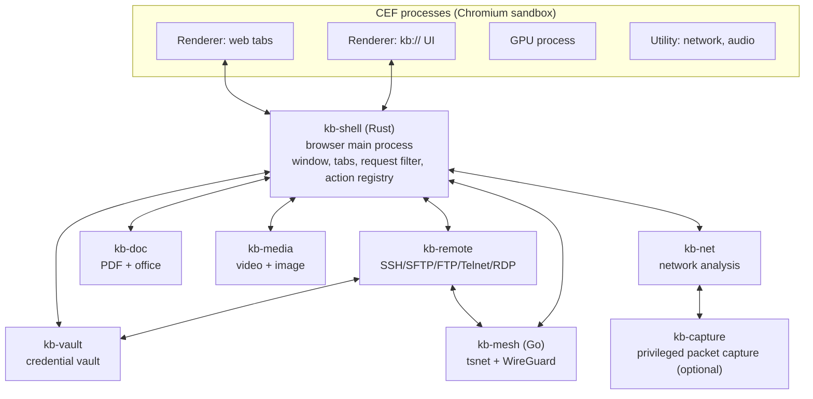
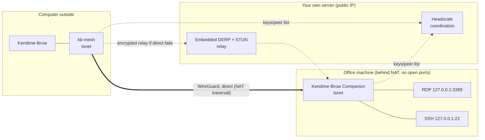

# Kendime-Brow — Architecture Design

**Version:** 1.0 · **Date:** 2026-11-12 · **Status:** Approved

This document is the single reference for whoever (person or model) does the implementation.
See [ROADMAP.md](../ROADMAP.md) for task order and [PROGRESS.md](../PROGRESS.md) for the decision history.

**Reading rule:** Every statement marked `(verify)` is an assumption that was not tested during
design; it must be confirmed from official documentation or with a small experiment before the
related task starts. All of them are collected in [Section 14](#14-assumptions-to-validate-and-risks).

## Contents

1. [Summary and key decisions](#1-summary-and-key-decisions)
2. [Technology foundation](#2-technology-foundation)
3. [System architecture](#3-system-architecture)
4. [Privacy strategy](#4-privacy-strategy)
5. [Performance and resource efficiency](#5-performance-and-resource-efficiency)
6. [File processing: PDF](#6-file-processing-pdf)
7. [File processing: Office documents](#7-file-processing-office-documents)
8. [File processing: Video, photo, archives](#8-file-processing-video-photo-archives)
9. [Network analysis module](#9-network-analysis-module)
10. [Remote connection module](#10-remote-connection-module)
11. [VPN/Mesh, Companion and Headscale server](#11-vpnmesh-companion-and-headscale-server)
12. [Extra features: prioritization](#12-extra-features-prioritization)
13. [Repo layout, build, versioning](#13-repo-layout-build-versioning)
14. [Assumptions to validate and risks](#14-assumptions-to-validate-and-risks)

---

## 1. Summary and key decisions

| # | Decision | Choice |
|---|---|---|
| K1 | Browser engine | CEF (Chromium Embedded Framework), prebuilt binary distribution |
| K2 | Shell language | Rust (to CEF via the `cef` crate / a thin C++ bridge if needed) |
| K3 | UI | HTML/TypeScript (SolidJS + Vite), served from the `kb://` custom scheme |
| K4 | Module isolation | Each heavy module is a separate OS process ("module host"), started on demand |
| K5 | Inter-process communication | Named pipe (Windows) / Unix socket; protobuf messages; shared memory for large data |
| K6 | Ad/tracker engine | `adblock-rust` (Brave's engine, MPL-2.0) |
| K7 | PDF | PDFium + qpdf + lopdf + Tesseract |
| K8 | Office | LibreOfficeKit (optionally downloaded component) |
| K9 | Media | FFmpeg (LGPL build, as a separate process) + Rust image libraries |
| K10 | SSH/SFTP/SCP | `russh` + `russh-sftp` |
| K11 | RDP | IronRDP (fallback: FreeRDP as a separate process) |
| K12 | Mesh client | `tsnet` (Tailscale's Go library, userspace WireGuard), connects to Headscale |
| K13 | Companion | Single-file Windows service written in Go, with embedded `tsnet` |
| K14 | Credential vault | Separate process (`kb-vault`), OS keyring + XChaCha20-Poly1305 |
| K15 | Target platform | Cross-platform, no primary platform: Windows, Linux, macOS. Verification order: Windows → Ubuntu → macOS (see 3.8) |
| K16 | Telemetry | None. The browser never connects to any server on its own (except the update check, which can be disabled) |

**License principle:** The project is Apache 2.0. Everything linked statically or dynamically must be
Apache/MIT/BSD/MPL/LGPL. GPL/AGPL components (Ghostscript, MuPDF, x264, exiv2, OnlyOffice) are
**not linked** into the code; if needed, they are only invoked as external executables that the user
installs separately.

---

## 2. Technology foundation

### 2.1 Why CEF

It provides Chromium's engine, multi-process model and sandbox as prebuilt binaries; there is no
100+ GB source tree and no constant rebasing burden. Since network requests can be intercepted on the
shell side, tracker blocking and network analysis are fed directly from this layer.
Because the file, remote connection and mesh modules are processes independent of the engine, most
of the work carries over unchanged even if the engine changes later (e.g. moving to a Chromium fork).

### 2.2 Known costs

- **Fingerprinting protection is not in-engine.** It is done only with command-line flags,
  preference settings, request header rewriting and per-page injected JS.
- **Chrome extension support is partial** (see 3.6).
- **Proprietary codecs (H.264/AAC) are disabled in official CEF binaries** `(verify)`. This breaks
  video playback on some sites. Solution: **our own CEF build**, unpatched but with the
  `proprietary_codecs=true ffmpeg_branding="Chrome"` arguments (monthly, automated).
  This is not a "fork": no patches, only build arguments. The first task of Phase 1 validates this.
- **Widevine DRM** (Netflix etc.) is not guaranteed `(verify)`; out of scope for v1.

### 2.3 Exit path

If in-engine privacy patches become necessary: the same shell is kept and the ungoogled-chromium patch
set is added to the CEF build (the "C+" path). Since the shell–engine boundary is only the CEF API,
the shell code does not change.

### 2.4 How CEF is used

CEF offers two browser styles `(verify)`:

| Style | Used for | Why |
|---|---|---|
| Chrome style | Web tabs | Chrome extensions, built-in PDF viewer, permission prompts |
| Alloy style | `kb://` UI and tool pages | Full control, no Chrome UI |

The window layout is built with CEF Views; Chrome's own toolbar is hidden
(`CEF_CTT_NONE`), and the entire UI is our `kb://ui` page.

### 2.5 Version policy

- CEF tracks Chromium stable within days. CEF is updated on every Chromium stable release (≈4 weeks)
  and every security patch release. **Security updates are never delayed by more than 7 days**;
  this is the project's most important maintenance obligation.
- The CEF version is pinned in `cef.lock`; the build script verifies the binary with SHA-256.

---

## 3. System architecture

### 3.1 Process map



| Process | Language | Lifetime | Privileges | Network access |
|---|---|---|---|---|
| `kb-shell` | Rust | Whole application | User | Only via CEF |
| CEF renderer/GPU/utility | C++ | Per tab | Chromium sandbox | Utility process |
| `kb-vault` | Rust | Starts on first vault access | Restricted token, no network, files only in the vault directory | **None** |
| `kb-doc` | Rust (+ PDFium, LOK, Tesseract) | On demand; exits after 5 min idle | AppContainer, no network | **None** |
| `kb-media` | Rust (+ FFmpeg subprocess) | On demand | AppContainer, no network | **None** |
| `kb-remote` | Rust | Starts with the first session | Restricted token | Yes (target servers) |
| `kb-mesh` | Go | While the mesh is up | User (no TUN/driver) | Yes (Headscale, DERP, peers) |
| `kb-net` | Rust | While the analysis panel is open | Restricted token | None |
| `kb-capture` | Rust | Only during actual packet capture | **Administrator (UAC)** | Capture driver |

**Design rules**

1. Processes that parse untrusted content (downloaded PDFs, documents, media) **have no network
   access** and only see the file handles given to them. That way a parser vulnerability cannot
   exfiltrate data.
2. Module hosts do not talk to each other directly; everything goes through `kb-shell`.
   Two exceptions: `kb-remote`→`kb-vault` (signing requests) and `kb-remote`→`kb-mesh` (opening connections).
3. A module host crash does not bring down the browser; `kb-shell` restarts it and shows an error in
   the related tab.
4. No module is loaded at startup. On a cold start only `kb-shell` + CEF run.

### 3.2 Sandbox (Windows details; see 3.8 for other platforms)

- **CEF processes:** The Chromium sandbox stays enabled (`--no-sandbox` is never used).
- **Module hosts:** `kb-shell` launches the child process with these restrictions:
  - AppContainer (empty capability list → no access to the network or user files), or, if
    AppContainer is not possible, a restricted token + low integrity level.
  - Job Object: memory cap, no child process creation (only FFmpeg allowed for `kb-media`),
    `KILL_ON_JOB_CLOSE`.
  - Files are passed not as paths but as **handles** opened and handed over by `kb-shell`.
- **Linux:** user namespace + seccomp-bpf + Landlock; handles passed via `SCM_RIGHTS`.
- **macOS:** `sandbox_init` profile (network and file access disabled); handles via `SCM_RIGHTS`.

### 3.3 IPC

- **Transport:** Windows named pipe (`\\.\pipe\kb-<pid>-<module>-<random>`), ACL limited to the
  current user's SID; `SOCK_SEQPACKET` Unix socket on Linux. Built on `tokio`.
- **Format:** 4-byte length prefix + protobuf (`prost`). Schemas live in `proto/`, a single source.
- **Large data:** Page bitmaps, RDP frames and video frames go through shared memory
  (`shared_memory` crate); messages carry only a handle + offset.
- **Authentication:** When launching a child process, `kb-shell` passes a single-use 256-bit token
  over an inherited handle; the side connecting to the pipe presents it in its first message.
- **UI ↔ shell:** `kb://` pages call into `kb-shell` via the CEF message router.
  Streaming data (terminal output, capture rows) uses a `kb://stream/<id>` custom scheme
  response. Web tabs **cannot access** this bridge (open only to the `kb://` origin).

### 3.4 UI layer

- `kb://ui` — window shell: tab strip (vertical/horizontal), address bar, side panel, command palette.
- `kb://pdf`, `kb://office`, `kb://media`, `kb://term`, `kb://rdp`, `kb://net`, `kb://mesh`,
  `kb://files`, `kb://settings` — each module's tool page; opened as a tab.
- Stack: TypeScript, SolidJS, Vite; no separate state management library (Solid store).
  `xterm.js` (with the WebGL addon) for the terminal, CodeMirror 6 for code/text.
- Assets are embedded in the binary (`rust-embed`); in development they are live-loaded from the Vite dev server.
- Strict CSP on `kb://` pages: `default-src 'self'`, no inline scripts, no external network requests.

### 3.5 Action registry (backbone of the command palette and chaining)

Every module writes its capabilities into the **action registry** in `kb-shell`:

```
Action { id: "pdf.merge", title, input schema, output schema, module, is_dangerous }
```

- The command palette, shortcuts, context menus and automation all use the same registry.
- Actions whose output type matches another's input type can be chained:
  `files.select → pdf.merge → pdf.compress(dpi=150) → file.save`.
- Chains are saved as YAML and run from the palette with a single command.
- The registry is built in Phase 1; every later module only adds actions.

### 3.6 Extension system

| Layer | Scope | Stage |
|---|---|---|
| Built-in content blocking | `adblock-rust`, no extension required | Phase 2 |
| User scripts | Built-in manager (Tampermonkey-compatible `@match`, `GM_*` subset) | Phase 6 |
| Chrome extensions (MV3) | Loading from an unpacked folder `(verify)`; no Web Store installation | Phase 6, best effort |

Extension compatibility is treated as a bonus, not a goal. Commonly used extension features
(ad blocking, password manager, userscripts) are provided built in.

### 3.7 Data directories

```
%LOCALAPPDATA%\Kendime-Brow\
  profiles\<name>\cef\        CEF profile data (one subdirectory per container)
  profiles\<name>\kb.sqlite   bookmarks, history, session, settings
  vault\vault.sqlite          encrypted vault (opened by nothing but kb-vault)
  components\                 optional components (LibreOffice, FFmpeg, Tesseract languages)
  logs\                       local logs (default: errors only, 7 days)
```

### 3.8 Cross-platform support

There is no primary platform; code is written platform-independent from day one. Since development
happens on a Windows machine, features are verified first on Windows, then in a local Ubuntu VM, and
finally (if hardware becomes available) on macOS. Kali is covered by the same Debian-based package as Ubuntu.

**Rules**

1. Platform-specific code lives only in the `kb-platform` crate and, on the Go side, in the
   `internal/platform` package; other crates do not use `#[cfg(target_os)]` but call this crate's traits.
2. A feature with no equivalent on a platform is not silently ignored: it appears in the UI as
   "not supported on this platform" and is recorded in the table below.
3. From Phase 1 on, CI builds and tests on a Windows + Ubuntu matrix; macOS is added to the matrix
   when macOS work starts. A build broken on any platform is not merged.
4. No phase counts as "done" until it is verified to work on Ubuntu as well.

| Abstraction (`kb-platform`) | Windows | Linux | macOS |
|---|---|---|---|
| Module host sandbox | AppContainer / restricted token + Job Object | user namespace + seccomp-bpf + Landlock | App Sandbox profile (`sandbox_init`) |
| IPC transport | Named pipe | Unix socket (`SOCK_SEQPACKET`) | Unix socket (`SOCK_STREAM` + length prefix) |
| Handle passing | Handle inheritance | `SCM_RIGHTS` | `SCM_RIGHTS` |
| Keyring | Credential Manager / DPAPI | Secret Service (GNOME Keyring, KWallet) | Keychain |
| Biometric unlock | Windows Hello | None (password) | Touch ID |
| Memory pressure | `QueryMemoryResourceNotification` | PSI (`/proc/pressure/memory`) | `dispatch` memory pressure source |
| Local shell PTY | ConPTY | `openpty` | `openpty` |
| Packet capture | Npcap / pktmon | libpcap (`CAP_NET_RAW`) | libpcap (BPF device permission) |
| Privilege elevation | UAC | polkit (`pkexec`) | Authorization Services |
| Service (Companion) | Windows service | systemd unit | launchd daemon |
| HEIC decoding | WIC | libheif (if installed by the user) | ImageIO |
| Data directory | `%LOCALAPPDATA%\Kendime-Brow` | `$XDG_DATA_HOME/kendime-brow` | `~/Library/Application Support/Kendime-Brow` |
| Packaging | MSI/EXE | `.deb` + AppImage | signed `.app` / `.dmg` |
| Hardware video encoder | NVENC, QSV, AMF, Media Foundation | NVENC, VAAPI | VideoToolbox |

**Companion readiness checker per platform:** RDP + OpenSSH Server on Windows (11.4);
`sshd` and, if present, `xrdp` / GNOME Remote Desktop on Linux; Remote Login (SSH) and
Screen Sharing on macOS. macOS has no RDP server (Screen Sharing uses VNC), so a VNC client for
macOS targets is a separate decision (V15).

**macOS-specific costs:** Signing and notarization are impossible without a paid Apple Developer
account; an unsigned app opens with a Gatekeeper warning. Building requires macOS hardware or a
macOS runner in CI.

---

## 4. Privacy strategy

### 4.1 No-data-collection principles

1. **No** telemetry, usage statistics or crash report uploads (crash dumps stay local only).
2. The browser never connects out without a user action. Exceptions can each be disabled in settings:
   update check (GitHub Releases), filter list updates.
3. Google services disabled: Safe Browsing, account sync, translation, spell-check service,
   search suggestions, field trials, component updater, suggestion/preloading services. Most of these
   do not work in CEF anyway since no API key is embedded; they are still explicitly disabled via
   flags and preferences.
4. **Validation test (CI):** All connections made during startup with an empty profile + 5 minutes
   idle are recorded with NetLog; any connection outside the allowlist breaks the build.

### 4.2 Tracker and ad blocking

- Engine: `adblock-rust`. Every request is checked against the engine in
  `CefResourceRequestHandler::OnBeforeResourceLoad`; the block / redirect / modify-header decision is applied.
- Lists: EasyList, EasyPrivacy, uBlock Origin lists, Turkish regional list, Peter Lowe.
  Daily updates with diff support. Users can add their own list URLs.
- Cosmetic filtering: CSS selectors produced by the engine are injected at document start.
- Scriptlet support (uBO-compatible resource files) — for anti-adblock walls.
- Tracking parameter stripping (`utm_*`, `fbclid`, `gclid` etc.) and skipping known redirect wrappers.
- CNAME cloaking detection: to the extent DNS resolution is visible to the shell `(verify)`.
- Per-site shield button: blocking level, statistics, one-click exception.

### 4.3 Cookies and storage

- Third-party cookies disabled by default; Chromium's storage partitioning enabled.
- **Containers:** Each container is a separate `CefRequestContext` (separate cookies, cache, storage,
  optionally a separate proxy). Default containers: Personal, Work, Temporary (wiped on close).
- Per-site "clear on close" rule. Global Privacy Control header enabled.

### 4.4 Fingerprinting protection

Three levels; default is **Standard**.

| Vector | Standard | Strict |
|---|---|---|
| User-Agent / Client Hints | Common current Chrome identity, reduced hints | Same |
| Canvas / WebGL readback | Consistent per-session + per-site noise (JS injection) | Readback requires permission |
| AudioContext | Per-session + per-site noise | Same |
| Font list | System font queries reduced to a fixed list | Same |
| WebRTC local IP | `disable_non_proxied_udp` policy | WebRTC disabled |
| Hardware (cores, memory) | Fixed values (8 cores, 8 GB) | Same |
| Screen / window size | Untouched | Rounded (letterboxing) |
| Time zone / language | Untouched | UTC / en-US |
| Battery, sensors, Bluetooth, USB, serial | API disabled | API disabled |

**Honest limit:** Protection done via JS injection is not as robust as in-engine patches;
a determined attacker can detect the injection. The goal is protection against common commercial
fingerprinting libraries; Tor Browser-level anonymity is **not** a goal.
The injection must run in the main world, before page scripts, in all frames `(verify)`.

### 4.5 Network privacy

- HTTPS-Only mode on; interstitial warning on HTTP sites.
- DNS-over-HTTPS: on by default, provider chosen by the user (Quad9 / Mullvad / own server).
- Preconnect, pre-resolution, preloading (prefetch/preconnect/prerender) disabled.
- Per-container proxy: SOCKS5 (combines with an SSH dynamic tunnel or a mesh exit node).
- Referer: origin only on cross-origin requests; `Sec-CH-*` headers reduced.

### 4.6 Local data

- History, bookmarks, session: local SQLite. Sensitive fields (vault) only in `kb-vault`.
- Private window: in-memory `CefRequestContext`, nothing is written to disk.
- "Panic" action: delete all session data + shut down the mesh + terminate remote sessions.

---

## 5. Performance and resource efficiency

### 5.1 Target budgets (to be measured and tracked in CI)

| Metric | Target |
|---|---|
| Cold start (window visible) | < 800 ms |
| Total RAM, empty window | < 250 MB |
| RAM with the same 10 tabs | ≥ 25% lower than Chrome |
| Idle CPU (10 background tabs) | < 1% |
| Module host first response | < 300 ms (excluding LibreOffice) |

### 5.2 Tab lifecycle

```
Active → Background (throttled timers) → Frozen (JS stopped) → Discarded (no process) → Sleeping (URL + title only)
```

- **Freezing:** tabs not visible for 5 min; via CDP `Page.setWebLifecycleState` `(verify)`.
- **Discarding:** after 30 min or under memory pressure; the browser object is destroyed and the tab
  strip keeps the URL, title, favicon, scroll position and a small screenshot.
  Reloaded when clicked.
- **Exceptions:** tabs playing audio, using the mic/camera, containing filled-in forms, pinned,
  with a download/upload in progress, with an open WebSocket/WebRTC session; user allowlist.
- **Memory pressure:** When free system memory drops below a threshold, the oldest background tabs
  are discarded first (Windows `QueryMemoryResourceNotification`).
- On session restore tabs open in the **sleeping** state; only the active tab is loaded.

### 5.3 Processes and memory

- The renderer process limit is configurable (`--renderer-process-limit`); default based on core
  count. Site isolation stays on for security.
- Module hosts start on demand and exit when idle (table in 3.1).
- Ad/tracker blocking alone noticeably reduces page memory and CPU, which is why it is on by default.
- Rust shell: `mimalloc`, zero background threads (event-driven).

### 5.4 Battery and network

- In battery mode: background tabs are frozen earlier (1 min), frame rate drops to 30,
  filter list/update checks are deferred, video autoplay is disabled.
- On metered connections (Windows metered): updates and component downloads stop; optional
  click-to-load for images.
- Autoplay off by default; no media preloading in background tabs.

### 5.5 Resource monitor

- Renderer processes report their PIDs to `kb-shell` via process messages; per-process RAM/CPU is
  read with `sysinfo` and mapped to tabs. Module hosts also appear in the list.
- Optional small indicator in the tab strip; full task manager on the `kb://tasks` page
  (sort, freeze, discard, kill).

---

## 6. File processing: PDF

**Host:** `kb-doc` (no network). **UI:** `kb://pdf`.

| Function | Library | License | Note |
|---|---|---|---|
| Quick viewing (PDFs on the web) | Chromium's built-in PDF viewer | BSD | Default in tabs; "Open in advanced tools" button |
| Rendering, text, forms (AcroForm), annotations | PDFium (`pdfium-render` crate) | BSD-3 / MIT | Main engine |
| Merge, split, reorder pages, rotate | `lopdf` | MIT | Object-level editing |
| Encryption, password removal, linearization, stream compression, repair | qpdf (as a library) | Apache-2.0 | AES-256, permission flags |
| Image resampling / compression | `image`, `mozjpeg`, `oxipng` | MIT/BSD | DPI-targeted downsizing |
| Color profile conversion | Little CMS 2 (`lcms2`) | MIT | sRGB/CMYK/gray, ICC embedding |
| OCR | Tesseract 5 + Leptonica | Apache-2.0 / BSD | Language packs downloaded on demand |
| Digital signature (PAdES) | `cms` + `x509-cert` (RustCrypto) + lopdf incremental save | Apache/MIT | **High risk**, see below |
| Table extraction | Own heuristic (PDFium text positions + line detection) | — | CSV/XLSX output |

**Advanced settings:** render DPI, color space, JPEG quality / lossless choice, image
downsampling threshold, font subsetting, metadata cleanup, encryption algorithm and permission
flags, PDF/A conversion (best effort), batch processing (folder input, naming template).

**OCR pipeline:** PDFium renders the page at the chosen DPI → Leptonica preprocessing (deskew,
binarization) → Tesseract → an invisible text layer is added to the page with lopdf.

**Signing risk:** There is no mature PAdES library in Rust. v1 scope: PAdES-B-B signing with a
PKCS#12 certificate and verifying existing signatures. Timestamps (B-T) and long-term validation
(LTV) in a later version. Turkish e-signature smart cards (PKCS#11) are a separate task.

**Deliberately out of scope:** Ghostscript and MuPDF (AGPL). If installed on the user's system they
can be invoked as an "external tool" in a separate process; they are not linked or bundled.

---

## 7. File processing: Office documents

**Host:** a separate subprocess inside `kb-doc` (`kb-doc-lok`), because a LibreOffice crash must not
affect PDF operations. **UI:** `kb://office`.

**Engine:** LibreOfficeKit (LOK), MPL-2.0. It is the only realistic open-source option: it opens,
edits and converts docx/xlsx/pptx/odt/ods/odp/rtf/csv and the legacy binary formats with a single engine.
OnlyOffice was ruled out because it is AGPL.

| Stage | Scope |
|---|---|
| 7a — Quick preview | Spreadsheet preview with `calamine` (xlsx/ods/csv reading, MIT) without installing LibreOffice |
| 7b — Viewing + conversion | LOK tile rendering → shared memory → `kb://office` canvas. Conversion between all formats, PDF export (with PDF/A, embedded fonts, image quality settings), batch conversion |
| 7c — Editing | In-place editing via LOK's input API (`postKeyEvent`, `postMouseEvent`, `postUnoCommand`); the toolbar in `kb://office` is bound to UNO commands |
| 7d — Advanced | Style/template manager, formula bar and function search (Calc engine), change tracking, macros |

- **Distribution:** LibreOffice is ~300 MB, so it is not part of the installer; it is downloaded
  into `components\` when the first office file is opened (with SHA-256 + signature verification).
  A LibreOffice installed on the system can be used instead.
- **Macros:** **Disabled** by default. With explicit per-document consent they run in a sandbox
  without network access. Signed macro policy is configurable.
- **Performance:** The first launch of `kb-doc-lok` takes 1–3 s; once running it is kept warm until
  it has been idle for 10 min.
- **Risk:** 7c (an editor UI on top of LOK) is one of the largest single work items in the project.
  7b alone is a releasable intermediate goal.

---

## 8. File processing: Video, photo, archives

**Host:** `kb-media` (no network). **UI:** `kb://media`, `kb://files`.

### 8.1 Video and audio

- **Engine:** FFmpeg, as `ffmpeg` / `ffprobe` **executables** in a subprocess (no library linking).
  Rationale: crash isolation, license cleanliness, easy updates.
- **Default package:** LGPL build. Encoders: hardware (NVENC, Quick Sync, AMF, Media
  Foundation), SVT-AV1, libvpx (VP9), OpenH264, libopus, libmp3lame.
- **Optional:** the user downloads a GPL build with x264/x265 themselves and points to its path.
- **Functions:** trimming (frame-accurate / keyframe cuts without re-encoding), concatenation,
  codec/container conversion, bitrate (CBR/VBR/CRF), resolution, frame rate, audio channels,
  subtitle embedding/extraction, metadata editing, GIF/WebP/APNG generation, batch queue.
- **Advanced:** presets + raw FFmpeg argument editor (the command to be run is always visible and
  copyable), two-pass encoding, filter graph, hardware acceleration selection.
- **Preview:** `<video>` inside `kb://media`; for formats Chromium cannot open, a low-resolution proxy
  stream is produced with FFmpeg.

### 8.2 Photo

| Function | Library | License |
|---|---|---|
| Decoding/encoding (JPEG, PNG, WebP, TIFF, BMP, GIF) | `image` crate | MIT |
| AVIF / JPEG XL | `libavif` / `libjxl` | BSD |
| HEIC | Windows Imaging Component (OS codec) | — |
| RAW | LibRaw | LGPL-2.1 (dynamic linking) |
| Resizing | `fast_image_resize` (SIMD) | MIT |
| Lossless/lossy optimization | `oxipng`, `mozjpeg` | MIT / BSD |
| Color management | Little CMS 2 | MIT |
| EXIF/IPTC/XMP reading | `kamadak-exif` + own XMP reader | BSD |
| Metadata writing/removal | `little_exif` or `img-parts` `(verify)` | MIT/Apache |

- **Functions:** crop, rotate, perspective, resize, format conversion, exposure/contrast/curves/
  white balance, sharpening, watermark, metadata viewing and selective removal (especially GPS),
  batch processing.
- Edits are kept as a **non-destructive** operation list and applied on export.
- `exiv2` is not used because it is GPL.

### 8.3 Archives and general file operations

- Archives: `libarchive` (BSD) — reading zip, tar, gz, bz2, xz, zstd, 7z, reading rar.
  `sevenz-rust` (Apache-2.0) for writing 7z. RAR **creation** is not available for licensing reasons.
- Download manager: pause/resume, speed limit, automatic checksum verification,
  per-type "open with" actions (PDF → `kb://pdf` etc.), rule-based folder sorting.
- `kb://files`: dual-pane file explorer, drag and drop, batch renaming, input source for action
  chains. Remote (SFTP/FTP) directories open as a second pane in the same UI.

---

## 9. Network analysis module

**Hosts:** `kb-net` (analysis), `kb-capture` (optional, privileged). **UI:** `kb://net`.

There are two layers; the first requires no privileges and is the default.

### 9.1 Layer 1 — In-browser (no privileges required)

| Source | Provides |
|---|---|
| Chrome DevTools Protocol, `Network` domain (CEF `SendDevToolsMessage` / observer) | Request/response headers and bodies, timing, initiator, WebSocket frames, cache status |
| Chromium NetLog | DNS resolution, socket opening, TLS handshake, HTTP/2 and QUIC session events, proxy decision |
| Request filter (4.2) | Which request was blocked by which rule |

Outputs: HAR 1.2, NetLog JSON, copy as cURL / `fetch` / Python `requests` command,
"Open in REST client" (see 12), edit and resend a request.

### 9.2 Layer 2 — Real packet capture (optional)

- Driver: **Npcap** (Windows) or libpcap (Linux). Npcap's license does not allow redistribution,
  so it is **not bundled**; the app checks whether it is installed, and if not, sends the user to the
  official site. Fallback: Windows built-in `pktmon` (ETW) → pcapng conversion.
- `kb-capture` is a small process elevated via UAC that lives only for the duration of a capture;
  it forwards raw packets to `kb-net` over a pipe and does nothing else.
- **Only the browser's traffic:** filtered by local port/endpoint pairs learned from NetLog socket
  events; packets from other applications are never written to disk.
- **TLS decryption:** CEF writes session keys via `--ssl-key-log-file`; the keys are embedded in the
  pcapng file as a Decryption Secrets Block, so the file also opens decrypted in Wireshark.
  The key file exists only during the capture and is securely deleted at the end.

### 9.3 Analysis

- Dissectors (Rust): `etherparse` (Ethernet/IP/TCP/UDP), `tls-parser`, `httparse`,
  HTTP/2 (`h2` frame layer), QUIC headers, DNS (`hickory-proto`), WebSocket.
- TCP stream reassembly and a "follow stream" view.
- **Filter language:** a small DSL similar to Wireshark display filters
  (`http.status >= 400 && host ~ "api\."`, `tcp.port == 443 && tls.sni contains "cdn"`).
  The parser is written with `chumsky`; field names are registered automatically from the protocol dissectors.
- Three-pane view (packet list / protocol tree / hex dump), timeline,
  statistics (endpoints, protocol distribution, slowest requests).
- Export: pcapng, HAR, CSV, JSON. Import: pcap/pcapng/HAR.
- If `tshark` is installed on the system it can optionally be used for deep protocol dissection.

**Privacy:** Captures may contain passwords and cookies. By default they are kept only in memory;
saving is an explicit action. Export has a "mask sensitive headers" option.
`*.pcap`, `*.pcapng`, `*.har` are in `.gitignore`.

---

## 10. Remote connection module

**Host:** `kb-remote`. **UI:** `kb://term` (SSH/Telnet/local shell), `kb://files`
(SFTP/FTP/SCP), `kb://rdp`.

### 10.1 Libraries

| Protocol | Library | License | Note |
|---|---|---|---|
| SSH | `russh` | Apache-2.0 | Pure Rust, async; ed25519/ECDSA/RSA-SHA2, modern KEX and ciphers |
| SFTP | `russh-sftp` | Apache-2.0 | |
| SCP | Own implementation over a `russh` exec channel | — | For old servers; SFTP is the default |
| Telnet | Own implementation (RFC 854 + NAWS, TTYPE, ECHO, SGA options) | — | Plaintext warning on every connection |
| FTP / FTPS | `suppaftp` | Apache-2.0/MIT | Explicit warning on plain FTP; FTPS (explicit TLS) preferred |
| RDP | IronRDP | Apache-2.0/MIT | NLA/CredSSP, TLS, RemoteFX/EGFX, clipboard, audio `(verify)` |
| RDP fallback | FreeRDP (separate process) | Apache-2.0 | For features IronRDP does not support |
| Local shell | `portable-pty` (ConPTY) | MIT | PowerShell, cmd, WSL, Git Bash |
| Terminal emulation | `xterm.js` | MIT | WebGL, ligatures, search, Sixel `(verify)` |

A serial port (network device console) can be added to the same terminal infrastructure with the
`serialport` crate; it is cheap and an optional Phase 4 task.

### 10.2 Credential security (`kb-vault`)

```
Master key (256-bit, random)
  ├─ default: wrapped with Windows Credential Manager / DPAPI (keyring crate)
  └─ optional: master password → Argon2id (m=256 MB, t=3) → wrapping key
Entries: SQLite; each entry XChaCha20-Poly1305 with its own nonce; associated data = entry ID + type
```

- `kb-vault` has no network, and only it opens the vault. Other processes do **not** request
  plaintext secrets; they request operations:
  - SSH private keys **never leave** the vault; `kb-remote` sends the data to be signed and the
    signature comes back (ssh-agent model).
  - For password-based protocols (RDP, FTP, Telnet) the secret is given to `kb-remote` for one use
    and zeroed from memory afterwards (`zeroize`).
- Memory protection: secrets in `secrecy` types, page locking (`VirtualLock`), excluded from crash dumps.
- Auto-lock: idle timeout, screen lock, sleep. Unlock with Windows Hello.
- External agents: Windows OpenSSH agent, Pageant, 1Password/KeePassXC agents; FIDO2 hardware keys
  (`sk-ed25519`) in a later version.
- Key generation (ed25519 by default), import (OpenSSH, PEM, PPK), action to copy the public key to a target.
- Export only as an encrypted archive and with explicit user confirmation.

### 10.3 Connection profiles

- Fields: name, protocol, host, port, user, authentication method (vault reference), jump host
  (ProxyJump chain), tunnels, environment variables, startup command, terminal theme,
  tags/folders, **network path** (direct / mesh / SOCKS).
- Import: `~/.ssh/config`, PuTTY sessions, `.rdp` files, MobaXterm/Termius exports (best effort).
- Profiles can be exported as unencrypted YAML that contains no secrets; secrets stay in the vault.
- Address bar schemes: `ssh://`, `sftp://`, `rdp://`, `telnet://`, `ftp://` open the relevant module.

### 10.4 Tunneling

- Local (`-L`), remote (`-R`), dynamic SOCKS5 (`-D`) forwarding; persistent tunnels per profile.
- **Browser integration:** A dynamic tunnel can be made a container's proxy with one click; tabs in
  that container browse as if inside the remote network (e.g. device web UIs at the office).
- Tunnel status appears in the same panel as `kb://mesh`.

### 10.5 Sessions

- Multi-session: tabs, split panes, session groups, "type to all" (broadcast).
- Reconnect, keepalive, session preservation on disconnect (`tmux` on the server is recommended).
- **Session logs:** Off by default. If enabled: timestamped plain text or asciicast, encrypted with
  the vault key; input following password prompts is not recorded.
- Host keys: fingerprint confirmation on first connection (TOFU), hard warning on change,
  `known_hosts` import/export.
- RDP display: `kb-remote` decodes frames → shared memory → native child window embedded in the tab
  area (`wgpu`). Dynamic resolution, multi-monitor, clipboard and drive redirection
  (off by default, enabled per profile).

---

## 11. VPN/Mesh, Companion and Headscale server

### 11.1 Overview



- **Headscale only coordinates:** it distributes public keys and the peer list.
  Traffic does not pass through it; it is end-to-end encrypted with WireGuard between the endpoints.
- The **DERP relay** is used only when a direct connection cannot be established and only sees
  encrypted packets. Headscale's embedded DERP is used to avoid depending on a third party.
- **No ports are opened** on the office router; both ends connect outward.

### 11.2 Why `tsnet`

`tsnet` embeds the Tailscale client as a library (BSD-3): userspace WireGuard +
userspace TCP/IP stack. Consequences:

- **No driver or admin rights required.** No virtual network adapter (Wintun) is installed; the
  browser joins the mesh as a normal user.
- **Not a system-wide VPN.** Only Kendime-Brow sees the mesh network; other applications' traffic is
  unaffected. This is the right scope for the intended use case ("connect to my own endpoints from
  the browser").
- Works directly with Headscale (`ControlURL` = own server).
- Cost: Go is a second toolchain. Accepted because there is no mature Rust client that speaks the
  Tailscale control protocol. `kb-mesh` is kept small (roughly a few hundred lines).

If a system-wide VPN is wanted, the official Tailscale client (pointed at Headscale with
`--login-server`) can be installed alongside; the architecture does not prevent this, but it is out of scope.

### 11.3 Browser side: `kb-mesh`

A Go process; talks to `kb-shell` and `kb-remote` over named pipes.

| RPC | Function |
|---|---|
| `Up(controlURL, authKey?)` / `Down()` | Join / leave the mesh |
| `Status()` | Own status, peers (name, mesh IP, online, direct/relay, latency, tags) |
| `Dial(host, port)` → stream | TCP connection over the mesh for `kb-remote` |
| `Socks5(start/stop)` | SOCKS5 on `127.0.0.1` only, random port + single-use credentials; for container proxies |
| `Ping(peer)` | Path type and latency measurement |
| `CompanionQuery(peer)` | Queries the peer's Companion status API (11.5) |

- Node state (machine key) is stored in `kb-vault`; never written to disk in plaintext.
- Enrollment: a **pre-auth key** generated in Headscale (single-use, short-lived) is pasted into the
  `kb://mesh` setup wizard; or, if Headscale OIDC is enabled, the user signs in in a browser tab.

**`kb://mesh` UI**

- Device list: online status, connection type (direct / relay), latency, operating system,
  Companion health summary.
- **One-click connect** buttons per device: RDP, SSH, SFTP, "browse through this device"
  (container proxy). Buttons appear according to the open services reported by Companion.
- Click flow: `kb-shell` → matching connection profile (a temporary one is created if none exists,
  network path = mesh) → `kb-remote` → `kb-mesh.Dial(peer, port)` → session tab opens.
- Headscale administration (optional, end of Phase 5): list/delete/rename nodes, generate pre-auth
  keys, edit ACLs. The Headscale API key is stored in `kb-vault`.

### 11.4 Kendime-Brow Companion

Separate software installed on the office machine (and other remote endpoints), carrying the same
identity as the browser.

**Form:** A single executable written in Go (`kb-companion.exe`), running as a Windows service
(automatic start, restart on crash). It has no UI; a small command line + an optional system tray
icon for setup and status. A systemd unit on Linux.

**Components**

1. **Mesh node:** embedded `tsnet`; registers with Headscale with the `tag:office` tag. Installs no driver.
2. **Service proxy:** Listens on the mesh interface and forwards to the local service:

   | Mesh port | Target | Default |
   |---|---|---|
   | 3389 | `127.0.0.1:3389` (RDP) | On |
   | 22 | `127.0.0.1:22` (OpenSSH Server) | On |
   | 47800 | Companion status API | On |
   | Custom | User-defined local/LAN targets | Off |

   Result: RDP and SSH do **not** need to be opened to the LAN in the Windows firewall; loopback
   alone is enough `(verify: RDP listening only on loopback / being bound to a rule)`.
3. **Readiness checker:** Checks at setup and periodically, and fixes if asked:
   - Is Remote Desktop enabled (`fDenyTSConnections`), is `TermService` running, is NLA required
   - Does the Windows edition support the RDP server (Home does not → warning)
   - Is OpenSSH Server installed and running; is password login disabled
   - Power settings: does sleep/hibernation make the machine unreachable → "don't sleep when plugged in" suggestion
   - Clock sync, disk usage, pending restart
   Every fix is made with explicit user consent and with admin rights during setup; the running
   service never silently changes system settings.
4. **Status API (mesh only):** `GET /v1/status` → version, uptime, open services, readiness check
   results, whether a user is logged in. `POST /v1/wake-lock` → prevent sleep for the duration of a
   connection. There are **no** other remote commands (SSH is used for running commands; the
   Companion attack surface is kept small).

**Setup flow**

1. A pre-auth key for the office machine is generated in Headscale (single-use, 1-hour lifetime,
   `tag:office`). This can also be done from the `kb://mesh` admin panel in the browser.
2. On the office machine: `kb-companion install --control https://<server> --authkey <key>`
   (or the setup wizard). The key is invalid after use; it is never written to disk.
3. The readiness checker runs, lists what is missing, and fixes it with consent.
4. The device appears in the browser's `kb://mesh` list within a few seconds.

**Browser ↔ Companion communication**

- There is **no** separate cloud service or message queue. Discovery comes from the peer list
  distributed by Headscale; status queries go directly to port 47800 on the peer's mesh IP.
- Authentication is at the mesh layer: Companion learns the connecting peer's identity via `tsnet`
  `WhoIs` and responds only to nodes tagged `tag:browser`. In addition, the Headscale ACL enforces
  the same rule at the packet level (double check).
- Updates: Companion does not update itself (by default); `kb://mesh` shows that a new version is
  available, and the update is done with a signed package and explicit consent.

**Security model (ACL draft)** — the real file never goes into the repo, this is only a sample:

```jsonc
{
  "tagOwners": { "tag:browser": ["emre"], "tag:office": ["emre"] },
  "acls": [
    { "action": "accept", "src": ["tag:browser"], "dst": ["tag:office:22,3389,47800"] }
  ]
  // Default: deny. tag:office nodes cannot initiate connections anywhere.
}
```

### 11.5 Headscale coordination server recommendations

**Machine**

| | Minimum | Recommended |
|---|---|---|
| CPU | 1 vCPU | 1–2 vCPU |
| RAM | 512 MB | 1 GB |
| Disk | 5 GB | 10 GB SSD |
| Network | Static public IPv4 | + IPv6 |
| Operating system | — | **Debian 13 (stable)** or Ubuntu Server 24.04 LTS |

- For a personal network of a few devices the load is negligible; SQLite is enough as the database.
- **A public IP is mandatory.** It will not work behind a home/office NAT; a small VPS is suitable.
  Preferably the server is not in the same location as the office network (so coordination doesn't
  go down if the office internet does).
- A domain name is required (e.g. `hs.<your-domain>`); Let's Encrypt for TLS.

**Ports to open (only these)**

| Port | Purpose |
|---|---|
| 443/tcp | Headscale control plane + embedded DERP (HTTPS) |
| 80/tcp | ACME HTTP-01 validation (certificates only; closed if TLS-ALPN is used) |
| 3478/udp | STUN (for NAT traversal) |
| 22/tcp | Admin SSH — preferably only from inside the mesh or from a fixed IP |

**Installation method:** Official `.deb` package + systemd (no Docker needed). TLS is terminated by
Headscale's built-in ACME support or by Caddy in front of it. The version is pinned; updates are done
manually after reading the release notes (there may be breaking changes between Headscale versions).

**Hardening checklist**

- [ ] SSH: keys only, `PermitRootLogin no`, `PasswordAuthentication no`; if possible close SSH to
      the public internet and allow access only via the mesh (the server becomes a tailnet node too)
- [ ] Firewall (nftables/ufw): default deny, only the ports above
- [ ] Automatic security updates with `unattended-upgrades`
- [ ] Headscale under a dedicated system user; systemd hardening (`NoNewPrivileges`,
      `ProtectSystem=strict`, `ProtectHome`, `PrivateTmp`, `CapabilityBoundingSet` only
      `CAP_NET_BIND_SERVICE`)
- [ ] The Headscale gRPC/admin API is **not** exposed to the public internet; remote administration
      only from inside the mesh. API keys expire (≤ 90 days)
- [ ] ACL default deny (11.4); new node enrollment only via pre-auth key or OIDC, open registration disabled
- [ ] Pre-auth keys: single-use, ≤ 1 hour lifetime, tagged
- [ ] Node key expiry: 90 days for browser nodes; expiry disabled for `tag:office` nodes
      (otherwise re-enrollment requires a trip to the office) — strict ACL instead
- [ ] Embedded DERP on, Tailscale's public DERP map off (no third-party dependency)
- [ ] MagicDNS on (reach devices by name); DNS logs off
- [ ] Backup: `db.sqlite` + `noise_private.key` + `config.yaml` daily, **encrypted** (`age`),
      off the server. These files never enter the repo
- [ ] Limited log retention (14 days); `fail2ban` or CrowdSec for SSH
- [ ] Monitoring: is the service running + certificate expiry; a simple external (uptime) check is enough
- [ ] Disaster plan: if the server goes down, existing direct connections survive for a while but no
      new connections can be made → restore-from-backup steps must be written in
      `docs/SERVER-SETUP.md` (Phase 5 task)

The repo contains only `deploy/headscale/config.example.yaml` and `acl.example.hujson`;
the real configuration and keys are excluded via `.gitignore`.

---

## 12. Extra features: prioritization

Evaluation criterion: value added to the browser ÷ additional cost (how much existing infrastructure it reuses).

**Decision (2026-11-12):** The P1 list is in scope. P2 is deferred (to be re-evaluated after
Phase 6), P3 is out of scope.

### P1 — Recommended (high value, infrastructure already exists)

| Feature | Why | Additional cost |
|---|---|---|
| Command palette + chainable actions | The backbone tying all modules together; the product's distinguishing feature | Already built in Phase 1 (3.5) |
| Resource monitor (per-tab RAM/CPU) | Makes the "efficient" claim visible; integrated with tab discarding | Low (5.5) |
| Built-in terminal (local shell) | A free by-product of the terminal infrastructure built for SSH | Very low |
| Password manager | `kb-vault` already exists; no lock-in thanks to KeePass (KDBX) import/export | Medium (hard part: secure autofill) |
| Checksum verification | Hooks into downloads automatically; high security value | Very low |
| Archive management | A natural part of the file manager (8.3) | Low |
| Regex / JSON / hash / encoding tools | Small, independent `kb://tools` pages; also usable in action chains | Low |
| User scripts | Compensates for partial extension support | Medium |

### P2 — Valuable, second wave

| Feature | Why | Additional cost |
|---|---|---|
| REST/API client | Strong combination with network analysis: edit and resend captured requests; credentials from the vault | Medium |
| Encrypted sync (to your own server) | Bookmarks, profiles, settings, vault; end-to-end encrypted blobs, SFTP/WebDAV target; over the mesh | Medium-high (conflict resolution) |
| Port scanner / ping / traceroute | Natural fit with mesh and remote connections; device diagnostics | Low-medium (raw socket privileges) |
| General OCR | Tesseract already exists; screen region / image → text | Low |
| Batch renaming | File manager add-on; uses the regex tools | Low |
| Screen recording + GIF | FFmpeg already exists; tab recording via CDP screencast, screen recording via Windows Graphics Capture | Medium |

### P3 — No priority / not recommended

| Feature | Why |
|---|---|
| Git integration | The job of an editor/IDE; would be half-baked in a browser. Suggested narrow scope: a "clone" action on repo pages and a diff viewer. A full client is unnecessary |
| Audio file processing | Conversion/trimming already comes for free with FFmpeg (8.1). A waveform editor is a separate product; low demand |

---

## 13. Repo layout, build, versioning

```
Kendime-Brow/
  Cargo.toml                 Rust workspace
  cef.lock                   Pinned CEF version + SHA-256
  crates/
    kb-shell/                Main process: window, tabs, request filter, action registry
    kb-platform/             Everything platform-specific: sandbox, keyring, PTY, memory pressure (3.8)
    kb-ipc/                  Transport, protobuf types, process launching
    kb-privacy/              adblock-rust wrapper, list management, fingerprint injection
    kb-vault/                Vault process
    kb-doc/                  PDF + office host
    kb-media/                Media host
    kb-remote/               Remote connection host
    kb-net/                  Network analysis
    kb-capture/              Privileged capture helper
    kb-actions/              Action registry types, chain executor
  go/
    kb-mesh/                 tsnet-based mesh process
    kb-companion/            Companion service
  ui/                        TypeScript + SolidJS (kb:// pages)
  proto/                     .proto schemas (single source for Rust, Go, TS)
  deploy/headscale/          *.example configurations, setup scripts
  docs/                      ARCHITECTURE.md, SERVER-SETUP.md, module notes
  scripts/                   CEF download, build, packaging
  ROADMAP.md  PROGRESS.md  README.md  README.tr.md  LICENSE
```

- **Toolchain:** Rust stable, Go ≥ 1.23, Node LTS + pnpm; MSVC build tools on Windows,
  `build-essential` + GTK/X11/Wayland development packages on Linux, Xcode command-line tools on macOS.
  Single-command tasks with `just` (`just dev`, `just build`, `just test`).
- **Development loop:** `just dev` starts the shell; the UI is live-loaded from Vite, and on Rust
  changes only the affected crate is rebuilt.
- **Automatic propagation to the installed app:** `just install-dev` links the installed version to
  the build output (junction); for releases, the auto-updater downloads a signed (`minisign`, ed25519)
  package from GitHub Releases and applies it on restart. The signing key is **never** in the repo.
- **Packaging:** Windows MSI/EXE, Linux `.deb` + AppImage, macOS `.dmg`. A single pinned icon in the
  taskbar/dock on every platform (on Windows all child processes share the same AppUserModelID).
- **CI (GitHub Actions):** `cargo fmt/clippy/test`, `go vet/test`, UI tests, license check
  (`cargo-deny`: a GPL/AGPL dependency breaks the build), secret scanning (`gitleaks`),
  the "zero unwanted connections" test from 4.1.
- **Versioning:** SemVer; throughout `0.x` each phase ends with a minor release.

---

## 14. Assumptions to validate and risks

### To validate (before the related task starts)

| # | Assumption | Section | Validation | If wrong |
|---|---|---|---|---|
| V1 | Official CEF binaries lack H.264/AAC | 2.2 | `canPlayType` on a test page | No need for our own build (good news) |
| V2 | Our own CEF build (codec arguments only) finishes in reasonable time | 2.2 | Try once, measure time/disk | Continue without codecs + investigate OS decoders |
| V3 | Chrome style + Alloy style in the same app, Chrome toolbar hidden | 2.4 | CEF sample app | All Alloy style; extension support drops |
| V4 | The Rust `cef` crate covers the needed APIs (Views, request handler, DevTools messages) | K2 | Phase 1 skeleton | Thin C++ bridge for missing parts |
| V5 | Unpacked MV3 extensions can be loaded | 3.6 | Try with uBlock Origin Lite | Extension support drops from scope |
| V6 | JS injection at document start, in the main world, in all frames is possible | 4.4 | CDP `Page.addScriptToEvaluateOnNewDocument` | Renderer-side `OnContextCreated` |
| V7 | Tab freezing via CDP works | 5.2 | Experiment | Skip freezing, discard directly |
| V8 | IronRDP: NLA, EGFX, clipboard, audio are mature enough | 10.1 | Connect to a Windows 11 target | FreeRDP subprocess becomes primary |
| V9 | RDP over loopback only via the Companion proxy works smoothly | 11.4 | Experiment | Firewall rule restricted to the mesh interface |
| V10 | `tsnet` is compatible with the current Headscale version | 11.2 | Test environment | Pin a compatible version pair |
| V11 | The metadata writing crate is sufficient | 8.2 | Experiment | Own EXIF writer (narrow scope) |
| V12 | Widevine does not work in CEF / requires a license | 2.2 | Research | DRM stays out of scope |
| V13 | The Rust `cef` crate also works on Linux and macOS (macOS has a different app bundle + helper process structure) | 3.8 | Repeat Phase 1.1 in the Ubuntu VM | C++ bridge |
| V14 | Landlock + seccomp on the Ubuntu LTS kernel is sufficient for module hosts | 3.8 | Experiment | Wrap with `bubblewrap` |
| V15 | Is a VNC client needed for remote desktop to macOS targets | 3.8 | User decision (at the macOS stage) | SSH only |

### Risks

| Risk | Impact | Mitigation |
|---|---|---|
| Security update delays | High | Policy in 2.5; automatic alerts from CEF version tracking |
| Scope too broad (solo developer) | High | Phases are independently releasable; each module has separate "minimal" and "advanced" stages |
| Editor on top of LOK (7c) | High | 7b intermediate goal; 7c can be deferred |
| PDF signing | Medium | Narrow v1 scope (6) |
| Two languages (Rust + Go) + TypeScript | Medium | Go only for mesh/companion; protobuf boundary |
| JS-based fingerprint protection can be bypassed | Medium | Limit documented openly; C+ path if needed (2.3) |
| Npcap cannot be redistributed | Low | Layer 1 covers most needs; pktmon fallback |
| Maintenance burden of three platforms | Medium-high | `kb-platform` boundary; CI matrix; macOS last |
| No macOS hardware / developer account | Medium | macOS is the last stage; code kept platform-independent |
