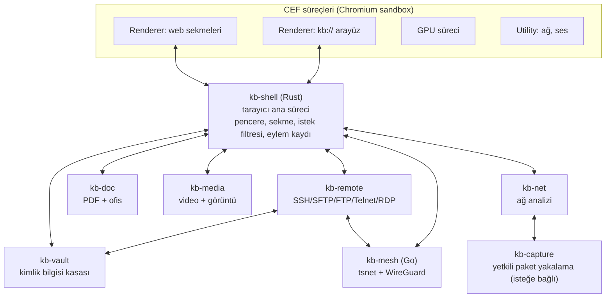
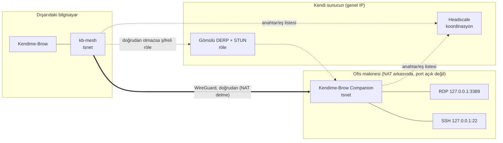

# Kendime-Brow — Mimari Tasarım

**Sürüm:** 1.0 · **Tarih:** 2026-11-12 · **Durum:** Onay bekliyor (ek özellik seçimi hariç tamam)

Bu doküman implementasyonu yapacak kişi/model için tek başvuru kaynağıdır.
Görev sırası için [ROADMAP.md](../ROADMAP.md), karar geçmişi için
[ilerleme-notlari.md](../ilerleme-notlari.md) dosyasına bakın.

**Okuma kuralı:** `(doğrula)` işaretli her ifade tasarım sırasında test edilmemiş bir
varsayımdır; ilgili görev başlamadan önce resmi dokümandan veya küçük bir denemeyle
teyit edilmelidir. Hepsi [Bölüm 14](#14-doğrulanacak-varsayımlar-ve-riskler)'te toplanmıştır.

## İçindekiler

1. [Özet ve temel kararlar](#1-özet-ve-temel-kararlar)
2. [Teknoloji temeli](#2-teknoloji-temeli)
3. [Sistem mimarisi](#3-sistem-mimarisi)
4. [Gizlilik stratejisi](#4-gizlilik-stratejisi)
5. [Performans ve kaynak tasarrufu](#5-performans-ve-kaynak-tasarrufu)
6. [Dosya işleme: PDF](#6-dosya-işleme-pdf)
7. [Dosya işleme: Ofis belgeleri](#7-dosya-işleme-ofis-belgeleri)
8. [Dosya işleme: Video, fotoğraf, arşiv](#8-dosya-işleme-video-fotoğraf-arşiv)
9. [Ağ analizi modülü](#9-ağ-analizi-modülü)
10. [Uzak bağlantı modülü](#10-uzak-bağlantı-modülü)
11. [VPN/Mesh, Companion ve Headscale sunucusu](#11-vpnmesh-companion-ve-headscale-sunucusu)
12. [Ek özellikler: önceliklendirme](#12-ek-özellikler-önceliklendirme)
13. [Repo yapısı, build, sürümleme](#13-repo-yapısı-build-sürümleme)
14. [Doğrulanacak varsayımlar ve riskler](#14-doğrulanacak-varsayımlar-ve-riskler)

---

## 1. Özet ve temel kararlar

| # | Karar | Seçim |
|---|---|---|
| K1 | Tarayıcı motoru | CEF (Chromium Embedded Framework), hazır binary dağıtım |
| K2 | Kabuk dili | Rust (CEF'e `cef` crate / gerekirse ince C++ köprüsü ile) |
| K3 | Arayüz | HTML/TypeScript (SolidJS + Vite), `kb://` özel şemasından sunulur |
| K4 | Modül izolasyonu | Her ağır modül ayrı işletim sistemi süreci ("modül konağı"), isteğe bağlı başlar |
| K5 | Süreçler arası iletişim | Named pipe (Windows) / Unix socket; protobuf mesajlar; büyük veri paylaşımlı bellek |
| K6 | Reklam/tracker motoru | `adblock-rust` (Brave'in motoru, MPL-2.0) |
| K7 | PDF | PDFium + qpdf + lopdf + Tesseract |
| K8 | Ofis | LibreOfficeKit (isteğe bağlı indirilen bileşen) |
| K9 | Medya | FFmpeg (LGPL build, ayrı süreç olarak) + Rust görüntü kütüphaneleri |
| K10 | SSH/SFTP/SCP | `russh` + `russh-sftp` |
| K11 | RDP | IronRDP (yedek: FreeRDP ayrı süreç) |
| K12 | Mesh istemcisi | `tsnet` (Tailscale'in Go kütüphanesi, userspace WireGuard), Headscale'e bağlanır |
| K13 | Companion | Go ile tek dosya Windows servisi, `tsnet` gömülü |
| K14 | Kimlik bilgisi kasası | Ayrı süreç (`kb-vault`), OS keyring + XChaCha20-Poly1305 |
| K15 | Hedef platform | Windows 10/11 x64 öncelikli; Linux ikinci; macOS kapsam dışı (varsayım, kullanıcı teyidi bekliyor) |
| K16 | Telemetri | Yok. Tarayıcı kendiliğinden hiçbir sunucuya bağlanmaz (güncelleme denetimi hariç, kapatılabilir) |

**Lisans ilkesi:** Proje Apache 2.0. Statik/dinamik bağlanan her şey Apache/MIT/BSD/MPL/LGPL
olmalı. GPL/AGPL bileşenler (Ghostscript, MuPDF, x264, exiv2, OnlyOffice) koda **bağlanmaz**;
gerekiyorsa yalnızca kullanıcının ayrıca kurduğu harici çalıştırılabilir dosya olarak çağrılır.

---

## 2. Teknoloji temeli

### 2.1 Neden CEF

Chromium'un motorunu, çoklu süreç modelini ve sandbox'ını hazır binary olarak verir;
100+ GB kaynak ağacı ve sürekli rebase yükü yoktur. Ağ istekleri kabuk tarafında
yakalanabildiği için tracker engelleme ve ağ analizi doğrudan bu katmandan beslenir.
Dosya, uzak bağlantı ve mesh modülleri motordan bağımsız süreçler olduğundan, işin büyük
kısmı ileride motor değişse bile (ör. Chromium fork'a geçiş) aynen taşınır.

### 2.2 Bilinen bedeller

- **Fingerprinting koruması motor içi değildir.** Yalnızca komut satırı bayrakları, tercih
  (preference) ayarları, istek başlığı düzenleme ve sayfa başına enjekte edilen JS ile yapılır.
- **Chrome eklenti desteği kısmidir** (bkz. 3.6).
- **Tescilli codec'ler (H.264/AAC) resmi CEF binary'lerinde kapalıdır** `(doğrula)`. Bu,
  bazı sitelerde video oynatmayı bozar. Çözüm: yamasız ama `proprietary_codecs=true
  ffmpeg_branding="Chrome"` argümanlarıyla **kendi CEF build'imiz** (ayda bir, otomatik).
  Bu "fork" değildir: yama yok, yalnız build argümanı. Faz 1'in ilk görevi bunu doğrulamaktır.
- **Widevine DRM** (Netflix vb.) garanti değildir `(doğrula)`; v1 kapsamı dışıdır.

### 2.3 Çıkış kapısı

Motor içi gizlilik yaması ihtiyacı doğarsa: aynı kabuk korunur, CEF build'ine
ungoogled-chromium yama seti eklenir ("C+" yolu). Kabuk–motor sınırı yalnızca CEF API'si
olduğu için kabuk kodu değişmez.

### 2.4 CEF çalışma biçimi

CEF iki tarayıcı stili sunar `(doğrula)`:

| Stil | Kullanım yeri | Neden |
|---|---|---|
| Chrome style | Web sekmeleri | Chrome eklentileri, yerleşik PDF görüntüleyici, izin istemleri |
| Alloy style | `kb://` arayüz ve araç sayfaları | Tam kontrol, Chrome arayüzü yok |

Pencere düzeni CEF Views ile kurulur; Chrome'un kendi araç çubuğu gizlenir
(`CEF_CTT_NONE`), tüm arayüz bizim `kb://ui` sayfamızdır.

### 2.5 Sürüm politikası

- CEF, Chromium stable'ı günler içinde takip eder. Her Chromium stable sürümünde (≈4 hafta)
  ve her güvenlik yaması sürümünde CEF güncellenir. **Güvenlik güncellemesi 7 günden fazla
  gecikmez**; bu, projenin en önemli bakım yükümlülüğüdür.
- CEF sürümü `cef.lock` dosyasında sabitlenir; build betiği binary'yi SHA-256 ile doğrular.

---

## 3. Sistem mimarisi

### 3.1 Süreç haritası



| Süreç | Dil | Ömür | Yetki | Ağ erişimi |
|---|---|---|---|---|
| `kb-shell` | Rust | Uygulama boyunca | Kullanıcı | Yalnız CEF üzerinden |
| CEF renderer/GPU/utility | C++ | Sekmeye göre | Chromium sandbox | Utility süreci |
| `kb-vault` | Rust | İlk kasaya erişimde başlar | Kısıtlı token, ağ yok, dosya yalnız kasa dizini | **Yok** |
| `kb-doc` | Rust (+ PDFium, LOK, Tesseract) | İstek üzerine; 5 dk boşta kapanır | AppContainer, ağ yok | **Yok** |
| `kb-media` | Rust (+ FFmpeg alt süreci) | İstek üzerine | AppContainer, ağ yok | **Yok** |
| `kb-remote` | Rust | İlk oturumda başlar | Kısıtlı token | Var (hedef sunucular) |
| `kb-mesh` | Go | Mesh açıkken | Kullanıcı (TUN/sürücü yok) | Var (Headscale, DERP, eşler) |
| `kb-net` | Rust | Analiz paneli açıkken | Kısıtlı token | Yok |
| `kb-capture` | Rust | Yalnız gerçek paket yakalama sırasında | **Yönetici (UAC)** | Yakalama sürücüsü |

**Tasarım kuralları**

1. Güvenilmeyen içeriği (indirilen PDF, belge, medya) ayrıştıran süreçlerin **ağ erişimi
   yoktur** ve yalnız kendilerine verilen dosya tanıtıcılarını görürler. Böylece bir
   ayrıştırıcı açığı veri sızdıramaz.
2. Modül konakları birbirleriyle doğrudan konuşmaz; her şey `kb-shell` aracılığıyla geçer.
   İki istisna: `kb-remote`→`kb-vault` (imzalama isteği) ve `kb-remote`→`kb-mesh` (bağlantı açma).
3. Bir modül konağının çökmesi tarayıcıyı düşürmez; `kb-shell` yeniden başlatır ve ilgili
   sekmede hata gösterir.
4. Hiçbir modül başlangıçta yüklenmez. Soğuk açılışta yalnız `kb-shell` + CEF çalışır.

### 3.2 Sandbox (Windows)

- **CEF süreçleri:** Chromium sandbox açık kalır (`--no-sandbox` asla kullanılmaz).
- **Modül konakları:** `kb-shell`, alt süreci şu kısıtlarla başlatır:
  - AppContainer (yetenek listesi boş → ağ ve kullanıcı dosyalarına erişim yok) veya
    AppContainer mümkün değilse kısıtlı token + düşük bütünlük seviyesi.
  - Job Object: bellek üst sınırı, alt süreç üretme yasağı (`kb-media` için yalnız FFmpeg izni),
    `KILL_ON_JOB_CLOSE`.
  - Dosyalar yol olarak değil, `kb-shell`'in açıp devrettiği **handle** olarak verilir.
- **Linux (ikinci aşama):** user namespace + seccomp-bpf + Landlock; aynı handle devri modeli.

### 3.3 IPC

- **Taşıma:** Windows named pipe (`\\.\pipe\kb-<pid>-<modül>-<rastgele>`), ACL yalnız
  mevcut kullanıcı SID'i; Linux'ta `SOCK_SEQPACKET` Unix socket. `tokio` üzerinde.
- **Biçim:** 4 bayt uzunluk öneki + protobuf (`prost`). Şemalar `proto/` dizininde, tek kaynak.
- **Büyük veri:** Sayfa bitmap'leri, RDP kareleri, video kareleri paylaşımlı bellekle
  (`shared_memory` crate), mesajda yalnız tanıtıcı + ofset taşınır.
- **Kimlik doğrulama:** `kb-shell` alt süreci başlatırken tek kullanımlık 256 bit belirteci
  devralınan handle üzerinden verir; pipe'a bağlanan taraf bunu ilk mesajda sunar.
- **Arayüz ↔ kabuk:** `kb://` sayfaları CEF message router ile `kb-shell`'e çağrı yapar.
  Akış verisi (terminal çıktısı, yakalama satırları) için `kb://stream/<id>` özel şema
  yanıtı kullanılır. Web sekmeleri bu köprüye **erişemez** (yalnız `kb://` kökenine açık).

### 3.4 Arayüz katmanı

- `kb://ui` — pencere kabuğu: sekme şeridi (dikey/yatay), adres çubuğu, yan panel, komut paleti.
- `kb://pdf`, `kb://office`, `kb://media`, `kb://term`, `kb://rdp`, `kb://net`, `kb://mesh`,
  `kb://files`, `kb://settings` — her modülün araç sayfası; sekme olarak açılır.
- Yığın: TypeScript, SolidJS, Vite; durum yönetimi için ayrı kütüphane yok (Solid store).
  Terminal için `xterm.js` (WebGL eklentisiyle), kod/metin için CodeMirror 6.
- Varlıklar binary'ye gömülür (`rust-embed`); geliştirmede Vite dev sunucusundan canlı yüklenir.
- `kb://` sayfalarında sıkı CSP: `default-src 'self'`, satır içi script yok, dış ağ isteği yok.

### 3.5 Eylem kaydı (komut paleti ve zincirleme omurgası)

Her modül, yeteneklerini `kb-shell`'deki **eylem kaydına** yazar:

```
Eylem { id: "pdf.merge", başlık, girdi şeması, çıktı şeması, modül, tehlikeli_mi }
```

- Komut paleti, kısayollar, sağ tık menüleri ve otomasyon aynı kaydı kullanır.
- Çıktı türü girdi türüyle uyuşan eylemler zincirlenir:
  `dosyalar.seç → pdf.merge → pdf.compress(dpi=150) → dosya.kaydet`.
- Zincirler YAML olarak kaydedilir ve paletten tek komutla çalışır.
- Bu kayıt Faz 1'de kurulur; sonraki her modül yalnızca eylem ekler.

### 3.6 Eklenti sistemi

| Katman | Kapsam | Aşama |
|---|---|---|
| Yerleşik içerik engelleme | `adblock-rust`, eklenti gerektirmez | Faz 2 |
| Kullanıcı scriptleri | Yerleşik yönetici (Tampermonkey uyumlu `@match`, `GM_*` alt kümesi) | Faz 6 |
| Chrome eklentileri (MV3) | Paketlenmemiş klasörden yükleme `(doğrula)`; Web Store kurulumu yok | Faz 6, en iyi çaba |

Eklenti uyumluluğu bir hedef değil, bonus olarak ele alınır. Sık kullanılan eklenti
işlevleri (reklam engelleme, şifre yöneticisi, userscript) yerleşik sunulur.

### 3.7 Veri dizinleri

```
%LOCALAPPDATA%\Kendime-Brow\
  profiles\<ad>\cef\        CEF profil verisi (konteyner başına alt dizin)
  profiles\<ad>\kb.sqlite   yer imleri, geçmiş, oturum, ayarlar
  vault\vault.sqlite        şifreli kasa (kb-vault dışında kimse açmaz)
  components\               isteğe bağlı bileşenler (LibreOffice, FFmpeg, Tesseract dilleri)
  logs\                     yerel loglar (varsayılan: yalnız hata, 7 gün)
```

---

## 4. Gizlilik stratejisi

### 4.1 Veri toplamama ilkeleri

1. Telemetri, kullanım istatistiği, çökme raporu gönderimi **yoktur** (çökme dökümü yalnız yerelde).
2. Tarayıcı kullanıcı eylemi olmadan dışarı bağlanmaz. İstisnalar ayarlardan tek tek kapatılır:
   güncelleme denetimi (GitHub Releases), filtre listesi güncellemesi.
3. Google servisleri kapalı: Safe Browsing, hesap senkronizasyonu, çeviri, yazım denetimi
   servisi, arama önerileri, alan denemeleri (field trials), bileşen güncelleyici, öneri/ön
   yükleme servisleri. CEF'te API anahtarı gömülü olmadığından çoğu zaten çalışmaz; yine de
   bayrak ve tercihlerle açıkça kapatılır.
4. **Doğrulama testi (CI):** Boş profille açılış + 5 dakika boşta bekleme sırasında çıkan
   tüm bağlantılar NetLog ile kaydedilir; izin listesi dışındaki her bağlantı build'i kırar.

### 4.2 Tracker ve reklam engelleme

- Motor: `adblock-rust`. `CefResourceRequestHandler::OnBeforeResourceLoad` içinde her istek
  motora sorulur; engelle / yönlendir / başlık değiştir kararı uygulanır.
- Listeler: EasyList, EasyPrivacy, uBlock Origin listeleri, Türkçe bölgesel liste, Peter Lowe.
  Günlük güncelleme, diff desteğiyle. Kullanıcı kendi liste URL'sini ekleyebilir.
- Kozmetik filtreleme: motorun ürettiği CSS seçicileri belge başında enjekte edilir.
- Scriptlet desteği (uBO uyumlu kaynak dosyaları) — anti-adblock duvarları için.
- İzleme parametresi temizleme (`utm_*`, `fbclid`, `gclid` vb.) ve bilinen yönlendirme
  sarmalayıcılarını atlama.
- CNAME gizleme (cloaking) tespiti: DNS çözümlemesi kabuğun görebildiği ölçüde `(doğrula)`.
- Site başına kalkan (shield) düğmesi: engelleme seviyesi, istatistik, tek tıkla istisna.

### 4.3 Çerez ve depolama

- Üçüncü taraf çerezleri varsayılan kapalı; Chromium'un depolama bölümleme özelliği açık.
- **Konteynerler:** Her konteyner ayrı `CefRequestContext` (ayrı çerez, önbellek, depolama,
  isteğe bağlı ayrı proxy). Hazır konteynerler: Kişisel, İş, Geçici (kapanınca silinir).
- Site başına "kapanışta temizle" kuralı. Global Privacy Control başlığı açık.

### 4.4 Fingerprinting koruması

Üç seviye; varsayılan **Standart**.

| Vektör | Standart | Sıkı |
|---|---|---|
| User-Agent / Client Hints | Yaygın güncel Chrome kimliği, azaltılmış ipuçları | Aynı |
| Canvas / WebGL okuma | Oturum + site başına tutarlı gürültü (JS enjeksiyonu) | Okuma izne bağlı |
| AudioContext | Oturum + site başına gürültü | Aynı |
| Yazı tipi listesi | Sistem yazı tipi sorguları sabit listeye indirgenir | Aynı |
| WebRTC yerel IP | `disable_non_proxied_udp` politikası | WebRTC kapalı |
| Donanım (çekirdek, bellek) | Sabit değerler (8 çekirdek, 8 GB) | Aynı |
| Ekran / pencere boyutu | Dokunulmaz | Yuvarlanmış (letterbox) |
| Saat dilimi / dil | Dokunulmaz | UTC / en-US |
| Batarya, sensörler, Bluetooth, USB, seri | API kapalı | API kapalı |

**Dürüst sınır:** JS enjeksiyonu ile yapılan koruma, motor içi yamalar kadar sağlam değildir;
kararlı bir saldırgan enjeksiyonu tespit edebilir. Hedef, yaygın ticari parmak izi
kütüphanelerine karşı korumadır; Tor Browser seviyesi anonimlik hedef **değildir**.
Enjeksiyon ana dünya (main world) bağlamında, sayfa scriptlerinden önce ve tüm çerçevelerde
çalışmalıdır `(doğrula)`.

### 4.5 Ağ gizliliği

- HTTPS-Only modu açık; HTTP sitede ara uyarı.
- DNS-over-HTTPS: varsayılan açık, sağlayıcı kullanıcı seçimi (Quad9 / Mullvad / kendi sunucu).
- Ön bağlantı, ön çözümleme, ön yükleme (prefetch/preconnect/prerender) kapalı.
- Konteyner başına proxy: SOCKS5 (SSH dinamik tüneli veya mesh çıkış düğümü ile birleşir).
- Referer: çapraz kökende yalnız köken; `Sec-CH-*` başlıkları azaltılır.

### 4.6 Yerel veri

- Geçmiş, yer imleri, oturum: yerel SQLite. Hassas alanlar (kasa) yalnız `kb-vault`'ta.
- Gizli pencere: bellek içi `CefRequestContext`, diske hiçbir şey yazılmaz.
- "Panik" eylemi: tüm oturum verisini sil + mesh'i kapat + uzak oturumları sonlandır.

---

## 5. Performans ve kaynak tasarrufu

### 5.1 Hedef bütçeler (ölçülecek, CI'da izlenecek)

| Ölçüt | Hedef |
|---|---|
| Soğuk açılış (pencere görünür) | < 800 ms |
| Boş pencere toplam RAM | < 250 MB |
| Aynı 10 sekmede RAM | Chrome'a göre ≥ %25 düşük |
| Boşta CPU (10 arka plan sekmesi) | < %1 |
| Modül konağı ilk yanıt | < 300 ms (LibreOffice hariç) |

### 5.2 Sekme yaşam döngüsü

```
Aktif → Arka plan (zamanlayıcı kısıtlı) → Dondurulmuş (JS durur) → Atılmış (süreç yok) → Uyku (yalnız URL + başlık)
```

- **Dondurma:** 5 dk görünmeyen sekme; CDP `Page.setWebLifecycleState` ile `(doğrula)`.
- **Atma (discard):** 30 dk veya bellek baskısında; tarayıcı nesnesi yok edilir, sekme
  şeridinde URL, başlık, favicon, kaydırma konumu ve küçük ekran görüntüsü kalır.
  Tıklanınca yeniden yüklenir.
- **İstisnalar:** ses çalan, mikrofon/kamera kullanan, doldurulmuş form içeren, sabitlenmiş,
  indirme/yükleme süren, WebSocket/WebRTC oturumu açık sekmeler; kullanıcı izin listesi.
- **Bellek baskısı:** Sistem boş belleği eşik altına düşünce en eski arka plan sekmelerinden
  başlanarak atılır (Windows `QueryMemoryResourceNotification`).
- Oturum geri yüklemede sekmeler **uyku** durumunda açılır; yalnız aktif sekme yüklenir.

### 5.3 Süreç ve bellek

- Renderer süreç sınırı ayarlanabilir (`--renderer-process-limit`); varsayılan çekirdek
  sayısına göre. Site izolasyonu güvenlik için açık kalır.
- Modül konakları isteğe bağlı başlar, boşta kalınca kapanır (3.1 tablosu).
- Reklam/tracker engelleme tek başına sayfa belleğini ve CPU'yu belirgin düşürür; bu yüzden
  varsayılan açıktır.
- Rust kabuk: `mimalloc`, sıfır arka plan iş parçacığı (olay güdümlü).

### 5.4 Batarya ve ağ

- Pil modunda: arka plan sekmeleri daha erken dondurulur (1 dk), kare hızı 30'a iner,
  filtre listesi/güncelleme denetimi ertelenir, video otomatik oynatma kapalı.
- Ölçülü bağlantıda (Windows metered): güncelleme ve bileşen indirme durur, görseller için
  isteğe bağlı tıklayınca yükle.
- Otomatik oynatma varsayılan kapalı; arka plan sekmelerinde medya ön yükleme yok.

### 5.5 Kaynak monitörü

- Renderer süreçleri kendi PID'lerini süreç mesajıyla `kb-shell`'e bildirir; `sysinfo` ile
  süreç başına RAM/CPU okunur ve sekmeyle eşlenir. Modül konakları da listede görünür.
- Sekme şeridinde isteğe bağlı küçük gösterge; `kb://tasks` sayfasında tam görev yöneticisi
  (sırala, dondur, at, sonlandır).

---

## 6. Dosya işleme: PDF

**Konak:** `kb-doc` (ağ yok). **Arayüz:** `kb://pdf`.

| İşlev | Kütüphane | Lisans | Not |
|---|---|---|---|
| Hızlı görüntüleme (web'deki PDF) | Chromium yerleşik PDF görüntüleyici | BSD | Sekmede varsayılan; "Gelişmiş araçlarda aç" düğmesi |
| Render, metin, form (AcroForm), açıklama | PDFium (`pdfium-render` crate) | BSD-3 / MIT | Ana motor |
| Birleştir, böl, sayfa sırala, döndür | `lopdf` | MIT | Nesne seviyesinde düzenleme |
| Şifreleme, parola kaldırma, doğrusallaştırma, akış sıkıştırma, onarım | qpdf (kütüphane olarak) | Apache-2.0 | AES-256, izin bayrakları |
| Görsel yeniden örnekleme / sıkıştırma | `image`, `mozjpeg`, `oxipng` | MIT/BSD | DPI hedefli küçültme |
| Renk profili dönüşümü | Little CMS 2 (`lcms2`) | MIT | sRGB/CMYK/gri, ICC gömme |
| OCR | Tesseract 5 + Leptonica | Apache-2.0 / BSD | Dil paketleri isteğe bağlı indirilir |
| Dijital imza (PAdES) | `cms` + `x509-cert` (RustCrypto) + lopdf artımlı kayıt | Apache/MIT | **Yüksek risk**, bkz. aşağı |
| Tablo çıkarma | Kendi sezgiseli (PDFium metin konumları + çizgi tespiti) | — | CSV/XLSX çıktı |

**İleri düzey ayarlar:** render DPI, renk uzayı, JPEG kalitesi / kayıpsız seçim, görsel alt
örnekleme eşiği, yazı tipi alt kümeleme, metadata temizleme, şifreleme algoritması ve izin
bayrakları, PDF/A dönüşümü (en iyi çaba), toplu işlem (klasör girdi, adlandırma şablonu).

**OCR hattı:** PDFium sayfayı seçilen DPI'da render eder → Leptonica ön işleme (eğim
düzeltme, ikilileştirme) → Tesseract → görünmez metin katmanı lopdf ile sayfaya eklenir.

**İmza riski:** Rust'ta olgun bir PAdES kütüphanesi yoktur. v1 kapsamı: PKCS#12 sertifika
ile PAdES-B-B imzalama ve mevcut imzaları doğrulama. Zaman damgası (B-T) ve uzun vadeli
doğrulama (LTV) sonraki sürüm. Türkiye e-imza akıllı kartları (PKCS#11) ayrı görevdir.

**Kapsam dışı (bilinçli):** Ghostscript ve MuPDF (AGPL). Kullanıcı sisteminde kuruluysa
"harici araç" olarak ayrı süreçte çağrılabilir; koda bağlanmaz, pakete konmaz.

---

## 7. Dosya işleme: Ofis belgeleri

**Konak:** `kb-doc` içinde ayrı alt süreç (`kb-doc-lok`), çünkü LibreOffice çökmesi PDF
işlemlerini etkilememeli. **Arayüz:** `kb://office`.

**Motor:** LibreOfficeKit (LOK), MPL-2.0. Gerçekçi tek açık kaynak seçenektir: docx/xlsx/pptx/
odt/ods/odp/rtf/csv ve eski ikili formatları tek motorla açar, düzenler, dönüştürür.
OnlyOffice AGPL olduğu için elendi.

| Aşama | Kapsam |
|---|---|
| 7a — Hızlı önizleme | `calamine` (xlsx/ods/csv okuma, MIT) ile LibreOffice kurulmadan tablo önizleme |
| 7b — Görüntüleme + dönüştürme | LOK döşeme (tile) render → paylaşımlı bellek → `kb://office` tuvali. Tüm formatlar arası dönüştürme, PDF dışa aktarma (PDF/A, gömülü yazı tipi, görsel kalitesi ayarlarıyla), toplu dönüştürme |
| 7c — Düzenleme | LOK'un girdi API'si (`postKeyEvent`, `postMouseEvent`, `postUnoCommand`) ile yerinde düzenleme; araç çubuğu `kb://office` içinde UNO komutlarına bağlanır |
| 7d — İleri düzey | Stil/şablon yöneticisi, formül çubuğu ve işlev arama (Calc motoru), değişiklik izleme, makrolar |

- **Dağıtım:** LibreOffice ~300 MB olduğu için kuruluma dahil değildir; ilk ofis dosyası
  açıldığında `components\` altına indirilir (SHA-256 + imza doğrulamalı). Sistemde kurulu
  LibreOffice varsa o kullanılabilir.
- **Makrolar:** Varsayılan **kapalı**. Belge başına açık onayla, ağ erişimi olmayan
  sandbox'ta çalışır. İmzalı makro politikası ayarlanabilir.
- **Performans:** `kb-doc-lok` ilk açılışı 1–3 sn sürer; açıldıktan sonra 10 dk boşta kalana
  kadar sıcak tutulur.
- **Risk:** 7c (LOK üzerine düzenleyici arayüzü) projenin en büyük tekil iş kalemlerinden
  biridir. 7b tek başına yayınlanabilir bir ara hedeftir.

---

## 8. Dosya işleme: Video, fotoğraf, arşiv

**Konak:** `kb-media` (ağ yok). **Arayüz:** `kb://media`, `kb://files`.

### 8.1 Video ve ses

- **Motor:** FFmpeg, `ffmpeg` / `ffprobe` **çalıştırılabilir dosyaları** olarak alt süreçte
  (kütüphane bağlama yok). Gerekçe: çökme izolasyonu, lisans temizliği, güncelleme kolaylığı.
- **Varsayılan paket:** LGPL build. Kodlayıcılar: donanım (NVENC, Quick Sync, AMF, Media
  Foundation), SVT-AV1, libvpx (VP9), OpenH264, libopus, libmp3lame.
- **İsteğe bağlı:** x264/x265 içeren GPL build'i kullanıcı kendisi indirip yolunu gösterir.
- **İşlevler:** kırpma (kare hassasiyetli / yeniden kodlamasız anahtar kare kesimi), birleştirme,
  codec/kapsayıcı dönüştürme, bitrate (CBR/VBR/CRF), çözünürlük, kare hızı, ses kanalları,
  altyazı gömme/çıkarma, metadata düzenleme, GIF/WebP/APNG üretimi, toplu kuyruk.
- **İleri düzey:** hazır ayarlar + ham FFmpeg argüman düzenleyici (çalıştırılacak komut her
  zaman görünür ve kopyalanabilir), iki geçişli kodlama, filtre grafiği, donanım hızlandırma seçimi.
- **Önizleme:** `kb://media` içinde `<video>`; Chromium'un açamadığı formatlar için FFmpeg
  ile düşük çözünürlüklü vekil (proxy) akış üretilir.

### 8.2 Fotoğraf

| İşlev | Kütüphane | Lisans |
|---|---|---|
| Kod çözme/kodlama (JPEG, PNG, WebP, TIFF, BMP, GIF) | `image` crate | MIT |
| AVIF / JPEG XL | `libavif` / `libjxl` | BSD |
| HEIC | Windows Imaging Component (OS codec'i) | — |
| RAW | LibRaw | LGPL-2.1 (dinamik bağlama) |
| Yeniden boyutlandırma | `fast_image_resize` (SIMD) | MIT |
| Kayıpsız/kayıplı optimizasyon | `oxipng`, `mozjpeg` | MIT / BSD |
| Renk yönetimi | Little CMS 2 | MIT |
| EXIF/IPTC/XMP okuma | `kamadak-exif` + kendi XMP okuyucu | BSD |
| Metadata yazma/silme | `little_exif` veya `img-parts` `(doğrula)` | MIT/Apache |

- **İşlevler:** kırpma, döndürme, perspektif, yeniden boyutlandırma, format dönüştürme,
  pozlama/kontrast/eğri/beyaz dengesi, keskinleştirme, filigran, metadata görüntüleme ve
  seçici silme (özellikle GPS), toplu işlem.
- Düzenleme **yıkıcı olmayan** işlem listesi olarak tutulur; dışa aktarımda uygulanır.
- `exiv2` GPL olduğu için kullanılmaz.

### 8.3 Arşiv ve genel dosya işlemleri

- Arşiv: `libarchive` (BSD) — zip, tar, gz, bz2, xz, zstd, 7z okuma, rar okuma. 7z yazma için
  `sevenz-rust` (Apache-2.0). RAR **oluşturma** lisans gereği yoktur.
- İndirilenler yöneticisi: duraklat/sürdür, hız sınırı, otomatik sağlama (checksum) doğrulama,
  türe göre "şununla aç" eylemi (PDF → `kb://pdf` vb.), kural tabanlı klasörleme.
- `kb://files`: çift panelli dosya gezgini, sürükle-bırak, toplu yeniden adlandırma, eylem
  zincirlerine girdi kaynağı. Uzak (SFTP/FTP) dizinler aynı arayüzde ikinci panel olarak açılır.

---

## 9. Ağ analizi modülü

**Konaklar:** `kb-net` (analiz), `kb-capture` (isteğe bağlı, yetkili). **Arayüz:** `kb://net`.

İki katman vardır; birincisi yetki gerektirmez ve varsayılandır.

### 9.1 Katman 1 — Tarayıcı içi (yetki gerekmez)

| Kaynak | Sağladığı |
|---|---|
| Chrome DevTools Protocol, `Network` alanı (CEF `SendDevToolsMessage` / gözlemci) | İstek/yanıt başlık ve gövdeleri, zamanlama, başlatıcı, WebSocket çerçeveleri, önbellek durumu |
| Chromium NetLog | DNS çözümleme, soket açılışı, TLS el sıkışması, HTTP/2 ve QUIC oturum olayları, proxy kararı |
| İstek filtresi (4.2) | Hangi isteğin hangi kuralla engellendiği |

Çıktılar: HAR 1.2, NetLog JSON, cURL / `fetch` / Python `requests` komutu olarak kopyalama,
"REST istemcisinde aç" (bkz. 12), isteği düzenleyip yeniden gönderme.

### 9.2 Katman 2 — Gerçek paket yakalama (isteğe bağlı)

- Sürücü: **Npcap** (Windows) veya libpcap (Linux). Npcap lisansı yeniden dağıtıma izin
  vermediği için **pakete konmaz**; kurulu mu diye bakılır, değilse kullanıcı resmi siteye
  yönlendirilir. Yedek: Windows yerleşik `pktmon` (ETW) → pcapng dönüştürme.
- `kb-capture` UAC ile yükseltilmiş, yalnız yakalama süresince yaşayan küçük bir süreçtir;
  ham paketleri pipe üzerinden `kb-net`'e aktarır, başka hiçbir şey yapmaz.
- **Yalnız tarayıcının trafiği:** NetLog soket olaylarından öğrenilen yerel port/uç nokta
  çiftleri ile filtrelenir; diğer uygulamaların paketleri diske yazılmaz.
- **TLS çözme:** CEF `--ssl-key-log-file` ile oturum anahtarlarını yazar; anahtarlar pcapng
  dosyasına Decryption Secrets Block olarak gömülür, böylece dosya Wireshark'ta da çözülmüş açılır.
  Anahtar dosyası yalnız yakalama sırasında tutulur ve sonunda güvenli silinir.

### 9.3 Analiz

- Ayrıştırıcılar (Rust): `etherparse` (Ethernet/IP/TCP/UDP), `tls-parser`, `httparse`,
  HTTP/2 (`h2` çerçeve katmanı), QUIC başlıkları, DNS (`hickory-proto`), WebSocket.
- TCP akış birleştirme ve "akışı takip et" görünümü.
- **Filtre dili:** Wireshark görüntüleme filtrelerine benzer küçük bir DSL
  (`http.status >= 400 && host ~ "api\."`, `tcp.port == 443 && tls.sni contains "cdn"`).
  Ayrıştırıcı `chumsky` ile yazılır; alan adları protokol ayrıştırıcılarından otomatik kaydedilir.
- Üç bölmeli görünüm (paket listesi / protokol ağacı / onaltılık döküm), zaman çizelgesi,
  istatistikler (uç noktalar, protokol dağılımı, en yavaş istekler).
- Dışa aktarma: pcapng, HAR, CSV, JSON. İçe aktarma: pcap/pcapng/HAR.
- Sistemde `tshark` varsa derin protokol ayrıştırma için isteğe bağlı kullanılabilir.

**Gizlilik:** Yakalamalar parola ve çerez içerebilir. Varsayılan olarak yalnız bellekte
tutulur; kaydetme açık eylemdir. Dışa aktarmada "hassas başlıkları maskele" seçeneği vardır.
`*.pcap`, `*.pcapng`, `*.har` `.gitignore` içindedir.

---

## 10. Uzak bağlantı modülü

**Konak:** `kb-remote`. **Arayüz:** `kb://term` (SSH/Telnet/yerel kabuk), `kb://files`
(SFTP/FTP/SCP), `kb://rdp`.

### 10.1 Kütüphaneler

| Protokol | Kütüphane | Lisans | Not |
|---|---|---|---|
| SSH | `russh` | Apache-2.0 | Saf Rust, async; ed25519/ECDSA/RSA-SHA2, modern KEX ve şifreler |
| SFTP | `russh-sftp` | Apache-2.0 | |
| SCP | `russh` exec kanalı üzerinde kendi uygulama | — | Eski sunucular için; varsayılan SFTP |
| Telnet | Kendi uygulama (RFC 854 + NAWS, TTYPE, ECHO, SGA seçenekleri) | — | Düz metin uyarısı her bağlantıda |
| FTP / FTPS | `suppaftp` | Apache-2.0/MIT | Düz FTP'de açık uyarı; FTPS (açık TLS) tercih edilir |
| RDP | IronRDP | Apache-2.0/MIT | NLA/CredSSP, TLS, RemoteFX/EGFX, pano, ses `(doğrula)` |
| RDP yedek | FreeRDP (ayrı süreç) | Apache-2.0 | IronRDP'nin desteklemediği özellikler için |
| Yerel kabuk | `portable-pty` (ConPTY) | MIT | PowerShell, cmd, WSL, Git Bash |
| Terminal öykünme | `xterm.js` | MIT | WebGL, ligatür, arama, Sixel `(doğrula)` |

Seri port (ağ cihazı konsolu) aynı terminal altyapısına `serialport` crate ile eklenebilir;
düşük maliyetlidir ve Faz 4 isteğe bağlı görevidir.

### 10.2 Kimlik bilgisi güvenliği (`kb-vault`)

```
Ana anahtar (256 bit, rastgele)
  ├─ varsayılan: Windows Credential Manager / DPAPI ile sarılır (keyring crate)
  └─ isteğe bağlı: ana parola → Argon2id (m=256 MB, t=3) → sarma anahtarı
Kayıtlar: SQLite; her kayıt ayrı nonce ile XChaCha20-Poly1305; ilişkili veri = kayıt kimliği + tür
```

- `kb-vault`'un ağı yoktur, kasayı yalnız o açar. Diğer süreçler düz metin sırrı **istemez**;
  işlem ister:
  - SSH özel anahtarları kasadan **çıkmaz**; `kb-remote` imzalanacak veriyi gönderir, imza
    geri döner (ssh-agent modeli).
  - Parola gereken protokollerde (RDP, FTP, Telnet) sır tek kullanımlık olarak `kb-remote`'a
    verilir, kullanım sonrası bellekten sıfırlanır (`zeroize`).
- Bellek koruması: sırlar `secrecy` türlerinde, sayfa kilitleme (`VirtualLock`), çökme
  dökümünden hariç.
- Otomatik kilit: boşta kalma süresi, ekran kilidi, uyku. Windows Hello ile açma.
- Dış ajanlar: Windows OpenSSH agent, Pageant, 1Password/KeePassXC ajanı; FIDO2 donanım
  anahtarları (`sk-ed25519`) sonraki sürüm.
- Anahtar üretme (ed25519 varsayılan), içe aktarma (OpenSSH, PEM, PPK), açık anahtarı
  hedefe kopyalama eylemi.
- Dışa aktarma yalnız şifreli arşiv olarak ve açık kullanıcı onayıyla.

### 10.3 Bağlantı profilleri

- Alanlar: ad, protokol, ana makine, port, kullanıcı, kimlik doğrulama yöntemi (kasa
  referansı), atlama sunucusu (ProxyJump zinciri), tüneller, ortam değişkenleri, başlangıç
  komutu, terminal teması, etiketler/klasörler, **ağ yolu** (doğrudan / mesh / SOCKS).
- İçe aktarma: `~/.ssh/config`, PuTTY oturumları, `.rdp` dosyaları, MobaXterm/Termius
  dışa aktarımları (en iyi çaba).
- Profiller şifresiz ama sır içermeyen YAML olarak dışa aktarılabilir; sırlar kasada kalır.
- Adres çubuğu şemaları: `ssh://`, `sftp://`, `rdp://`, `telnet://`, `ftp://` ilgili modülü açar.

### 10.4 Tünelleme

- Yerel (`-L`), uzak (`-R`), dinamik SOCKS5 (`-D`) yönlendirme; profil başına kalıcı tüneller.
- **Tarayıcı entegrasyonu:** Bir dinamik tünel tek tıkla bir konteynerin proxy'si yapılır;
  o konteynerdeki sekmeler uzak ağın içindeymiş gibi gezer (ör. ofisteki cihaz arayüzleri).
- Tünel durumu `kb://mesh` ile aynı panelde görünür.

### 10.5 Oturumlar

- Çoklu oturum: sekmeler, bölünmüş paneller, oturum grupları, "hepsine yaz" (broadcast).
- Yeniden bağlanma, keepalive, bağlantı kopunca oturumu koruma (sunucuda `tmux` varsa önerilir).
- **Oturum logları:** Varsayılan kapalı. Açılırsa: zaman damgalı düz metin veya asciicast,
  kasa anahtarıyla şifreli; parola istemlerinden sonraki girdi kaydedilmez.
- Ana makine anahtarı: ilk bağlantıda parmak izi onayı (TOFU), değişiklikte sert uyarı,
  `known_hosts` içe/dışa aktarma.
- RDP görüntüsü: `kb-remote` kareleri çözer → paylaşımlı bellek → sekme alanına gömülü yerel
  alt pencere (`wgpu`). Dinamik çözünürlük, çoklu monitör, pano ve sürücü yönlendirme
  (varsayılan kapalı, profil başına açılır).

---

## 11. VPN/Mesh, Companion ve Headscale sunucusu

### 11.1 Genel resim



- **Headscale yalnız koordinasyon yapar:** açık anahtarları ve eş listesini dağıtır.
  Trafik onun üzerinden geçmez; uçlar arasında uçtan uca WireGuard ile şifrelidir.
- **DERP rölesi** yalnız doğrudan bağlantı kurulamadığında devreye girer ve yalnız şifreli
  paket görür. Üçüncü tarafa bağımlı olmamak için Headscale'in gömülü DERP'i kullanılır.
- Ofis yönlendiricisinde **port açılmaz**; her iki uç da dışarı doğru bağlantı kurar.

### 11.2 Neden `tsnet`

`tsnet`, Tailscale istemcisini kütüphane olarak gömer (BSD-3): userspace WireGuard +
userspace TCP/IP yığını. Sonuçları:

- **Sürücü ve yönetici yetkisi gerekmez.** Sanal ağ kartı (Wintun) kurulmaz; tarayıcı normal
  kullanıcı olarak mesh'e katılır.
- **Sistem geneli VPN değildir.** Yalnız Kendime-Brow mesh ağını görür; diğer uygulamaların
  trafiği etkilenmez. İstenen kullanım senaryosu ("kendi uçlarıma tarayıcıdan bağlan") için
  doğru kapsam budur.
- Headscale ile doğrudan çalışır (`ControlURL` = kendi sunucu).
- Bedel: Go ikinci bir araç zinciridir. Rust'ta Tailscale kontrol protokolünü konuşan olgun
  bir istemci olmadığı için kabul edilmiştir. `kb-mesh` küçük (yaklaşık birkaç yüz satır) tutulur.

Sistem geneli VPN istenirse resmi Tailscale istemcisi (`--login-server` ile Headscale'e
bağlı) yan yana kurulabilir; mimari bunu engellemez, kapsam dışıdır.

### 11.3 Tarayıcı tarafı: `kb-mesh`

Go süreci; `kb-shell` ve `kb-remote` ile named pipe üzerinden konuşur.

| RPC | İşlev |
|---|---|
| `Up(controlURL, authKey?)` / `Down()` | Mesh'e katıl / ayrıl |
| `Status()` | Kendi durumu, eşler (ad, mesh IP, çevrimiçi, doğrudan/röle, gecikme, etiketler) |
| `Dial(host, port)` → akış | `kb-remote` için mesh üzerinden TCP bağlantısı |
| `Socks5(start/stop)` | Yalnız `127.0.0.1`'de, rastgele port + tek kullanımlık kimlik bilgili SOCKS5; konteyner proxy'si için |
| `Ping(peer)` | Yol türü ve gecikme ölçümü |
| `CompanionQuery(peer)` | Eşin Companion durum API'sini sorgular (11.5) |

- Düğüm durumu (makine anahtarı) `kb-vault`'ta saklanır; diske düz yazılmaz.
- Kayıt: Headscale'de üretilen **ön kimlik doğrulama anahtarı** (tek kullanımlık, kısa
  ömürlü) `kb://mesh` kurulum sihirbazına yapıştırılır; veya Headscale OIDC açıksa tarayıcı
  sekmesinde oturum açılır.

**`kb://mesh` arayüzü**

- Cihaz listesi: çevrimiçi durumu, bağlantı türü (doğrudan / röle), gecikme, işletim sistemi,
  Companion sağlık özeti.
- Cihaz başına **tek tıkla bağlan** düğmeleri: RDP, SSH, SFTP, "bu cihaz üzerinden gez"
  (konteyner proxy'si). Düğmeler Companion'ın bildirdiği açık servislere göre görünür.
- Tıklama akışı: `kb-shell` → eşleşen bağlantı profili (yoksa geçici oluşturur, ağ yolu =
  mesh) → `kb-remote` → `kb-mesh.Dial(eş, port)` → oturum sekmesi açılır.
- Headscale yönetimi (isteğe bağlı, Faz 5 sonu): düğüm listele/sil/yeniden adlandır, ön
  anahtar üret, ACL düzenle. Headscale API anahtarı `kb-vault`'ta tutulur.

### 11.4 Kendime-Brow Companion

Ofis makinesine (ve diğer uzak uçlara) kurulan, tarayıcıyla aynı kimliği taşıyan ayrı yazılım.

**Biçim:** Go ile tek çalıştırılabilir dosya (`kb-companion.exe`), Windows servisi olarak
çalışır (otomatik başlangıç, çökünce yeniden başlatma). Arayüzü yoktur; kurulum ve durum için
küçük bir komut satırı + sistem tepsisi simgesi (isteğe bağlı). Linux'ta systemd birimi.

**Bileşenler**

1. **Mesh düğümü:** `tsnet` gömülü; Headscale'e `tag:office` etiketiyle kayıt olur. Sürücü
   kurmaz.
2. **Servis vekili (proxy):** Mesh arayüzünde dinler, yerel servise aktarır:

   | Mesh portu | Hedef | Varsayılan |
   |---|---|---|
   | 3389 | `127.0.0.1:3389` (RDP) | Açık |
   | 22 | `127.0.0.1:22` (OpenSSH Server) | Açık |
   | 47800 | Companion durum API'si | Açık |
   | Özel | Kullanıcının tanımladığı yerel/LAN hedefleri | Kapalı |

   Sonuç: RDP ve SSH'ın Windows güvenlik duvarında LAN'a açılması **gerekmez**; yalnız
   geri döngü (loopback) yeterlidir `(doğrula: RDP'nin yalnız loopback'te dinlemesi/kurala
   bağlanması)`.
3. **Hazırlık denetçisi:** Kurulumda ve periyodik olarak kontrol eder, istenirse düzeltir:
   - Uzak Masaüstü açık mı (`fDenyTSConnections`), `TermService` çalışıyor mu, NLA zorunlu mu
   - Windows sürümü RDP sunucusunu destekliyor mu (Home sürümü desteklemez → uyarı)
   - OpenSSH Server kurulu ve çalışıyor mu; parola ile giriş kapalı mı
   - Güç ayarları: uyku/hazırda bekleme makineyi erişilmez yapar mı → "prizdeyken uyuma" önerisi
   - Saat eşitlemesi, disk doluluğu, bekleyen yeniden başlatma
   Her düzeltme açık kullanıcı onayıyla ve kurulum sırasında yönetici yetkisiyle yapılır;
   servis çalışırken sessizce sistem ayarı değiştirmez.
4. **Durum API'si (yalnız mesh üzerinde):** `GET /v1/status` → sürüm, çalışma süresi, açık
   servisler, hazırlık denetimi sonuçları, oturum açmış kullanıcı var mı. `POST /v1/wake-lock`
   → bağlantı süresince uykuyu engelle. Başka uzaktan komut **yoktur** (komut çalıştırma için
   SSH kullanılır; Companion saldırı yüzeyi küçük tutulur).

**Kurulum akışı**

1. Headscale'de ofis makinesi için ön anahtar üretilir (tek kullanımlık, 1 saat ömürlü,
   `tag:office`). Bu işlem tarayıcıdaki `kb://mesh` yönetim panelinden de yapılabilir.
2. Ofis makinesinde: `kb-companion install --control https://<sunucu> --authkey <anahtar>`
   (veya kurulum sihirbazı). Anahtar kullanıldıktan sonra geçersizdir; diske yazılmaz.
3. Hazırlık denetçisi çalışır, eksikleri listeler, onayla düzeltir.
4. Cihaz birkaç saniye içinde tarayıcının `kb://mesh` listesinde görünür.

**Tarayıcı ↔ Companion haberleşmesi**

- Ayrı bir bulut servisi veya mesaj kuyruğu **yoktur**. Keşif Headscale'in dağıttığı eş
  listesinden gelir; durum sorgusu doğrudan eşin mesh IP'sindeki 47800 portuna yapılır.
- Kimlik doğrulama mesh katmanındadır: Companion, bağlanan eşin kimliğini `tsnet` `WhoIs`
  ile öğrenir ve yalnız `tag:browser` etiketli düğümlere yanıt verir. Buna ek olarak
  Headscale ACL'i paket seviyesinde aynı kuralı uygular (çift kontrol).
- Güncelleme: Companion kendi kendini güncellemez (varsayılan); `kb://mesh` yeni sürüm
  olduğunu gösterir, güncelleme imzalı paketle ve açık onayla yapılır.

**Güvenlik modeli (ACL taslağı)** — gerçek dosya repoya konmaz, yalnız örnek:

```jsonc
{
  "tagOwners": { "tag:browser": ["emre"], "tag:office": ["emre"] },
  "acls": [
    { "action": "accept", "src": ["tag:browser"], "dst": ["tag:office:22,3389,47800"] }
  ]
  // Varsayılan: reddet. tag:office düğümleri hiçbir yere bağlantı başlatamaz.
}
```

### 11.5 Headscale koordinasyon sunucusu önerileri

**Makine**

| | Minimum | Önerilen |
|---|---|---|
| CPU | 1 vCPU | 1–2 vCPU |
| RAM | 512 MB | 1 GB |
| Disk | 5 GB | 10 GB SSD |
| Ağ | Sabit genel IPv4 | + IPv6 |
| İşletim sistemi | — | **Debian 13 (stable)** veya Ubuntu Server 24.04 LTS |

- Birkaç cihazlık kişisel ağ için yük ihmal edilebilir düzeydedir; veritabanı SQLite yeterlidir.
- **Genel IP zorunludur.** Sunucu ev/ofis NAT'ı arkasındaysa çalışmaz; küçük bir VPS uygundur.
  Sunucunun ofis ağıyla aynı yerde olmaması tercih edilir (ofis interneti kesilirse
  koordinasyon da gitmesin).
- Bir alan adı gerekir (ör. `hs.<alan-adın>`); TLS için Let's Encrypt.

**Açılacak portlar (yalnız bunlar)**

| Port | Amaç |
|---|---|
| 443/tcp | Headscale kontrol düzlemi + gömülü DERP (HTTPS) |
| 80/tcp | ACME HTTP-01 doğrulaması (yalnız sertifika için; TLS-ALPN kullanılırsa kapatılır) |
| 3478/udp | STUN (NAT delme için) |
| 22/tcp | Yönetim SSH'ı — tercihen yalnız mesh içinden veya sabit IP'den |

**Kurulum biçimi:** Resmi `.deb` paketi + systemd (Docker gerekmez). TLS'i Headscale'in
yerleşik ACME desteği veya önüne konan Caddy sonlandırır. Sürüm sabitlenir, güncellemeler
sürüm notları okunarak elle yapılır (Headscale sürümleri arasında kırıcı değişiklik olabilir).

**Sertleştirme denetim listesi**

- [ ] SSH: yalnız anahtar, `PermitRootLogin no`, `PasswordAuthentication no`; mümkünse SSH'ı
      genel internete kapatıp yalnız mesh üzerinden erişim (sunucu da tailnet düğümü olur)
- [ ] Güvenlik duvarı (nftables/ufw): varsayılan reddet, yalnız yukarıdaki portlar
- [ ] `unattended-upgrades` ile otomatik güvenlik güncellemeleri
- [ ] Headscale ayrı sistem kullanıcısıyla; systemd sertleştirme (`NoNewPrivileges`,
      `ProtectSystem=strict`, `ProtectHome`, `PrivateTmp`, `CapabilityBoundingSet` yalnız
      `CAP_NET_BIND_SERVICE`)
- [ ] Headscale gRPC/yönetim API'si genel internete **açılmaz**; uzaktan yönetim yalnız mesh
      içinden. API anahtarları süreli (≤ 90 gün)
- [ ] ACL varsayılan reddet (11.4); yeni düğüm kaydı yalnız ön anahtar veya OIDC ile,
      açık kayıt kapalı
- [ ] Ön anahtarlar: tek kullanımlık, ≤ 1 saat ömürlü, etiketli
- [ ] Düğüm anahtarı süresi: tarayıcı düğümleri 90 gün; `tag:office` düğümleri için süre
      dolumu kapalı (yoksa ofise gitmeden yeniden kayıt gerekir) — bunun yerine ACL sıkı
- [ ] Gömülü DERP açık, Tailscale'in genel DERP haritası kapalı (üçüncü taraf bağımlılığı yok)
- [ ] MagicDNS açık (cihazlara adla erişim); DNS logları kapalı
- [ ] Yedek: `db.sqlite` + `noise_private.key` + `config.yaml` günlük, **şifreli** (`age`),
      sunucu dışına. Bu dosyalar asla repoya girmez
- [ ] Log saklama sınırlı (14 gün); `fail2ban` veya CrowdSec SSH için
- [ ] İzleme: servis çalışıyor mu + sertifika süresi; basit bir dış kontrol (uptime) yeterli
- [ ] Felaket planı: sunucu giderse mevcut doğrudan bağlantılar bir süre yaşar ama yeni
      bağlantı kurulamaz → yedekten geri yükleme adımları `docs/sunucu-kurulum.md` içinde
      yazılı olmalı (Faz 5 görevi)

Repoda yalnız `deploy/headscale/config.example.yaml` ve `acl.example.hujson` bulunur;
gerçek yapılandırma ve anahtarlar `.gitignore` ile dışlanmıştır.

---

## 12. Ek özellikler: önceliklendirme

Değerlendirme ölçütü: tarayıcıya kattığı değer ÷ ek maliyet (mevcut altyapıyı ne kadar
yeniden kullandığı). **Seçim kullanıcıya aittir**; aşağısı öneridir.

### P1 — Öneriyorum (yüksek değer, altyapısı zaten var)

| Özellik | Neden | Ek maliyet |
|---|---|---|
| Komut paleti + zincirlenebilir eylemler | Tüm modülleri birleştiren omurga; ürünün ayırt edici özelliği | Faz 1'de zaten kuruluyor (3.5) |
| Kaynak monitörü (sekme bazlı RAM/CPU) | "Tasarruflu" iddiasını görünür kılar; sekme atma ile bütünleşik | Düşük (5.5) |
| Yerleşik terminal (yerel kabuk) | SSH için kurulan terminal altyapısının bedava yan ürünü | Çok düşük |
| Şifre yöneticisi | `kb-vault` zaten var; KeePass (KDBX) içe/dışa aktarma ile kilitlenme yok | Orta (zor kısım: güvenli otomatik doldurma) |
| Checksum doğrulama | İndirilenlere otomatik bağlanır; güvenlik değeri yüksek | Çok düşük |
| Arşiv yönetimi | Dosya yöneticisinin doğal parçası (8.3) | Düşük |
| Regex / JSON / hash / kodlama araçları | Küçük, bağımsız `kb://tools` sayfaları; eylem zincirlerinde de kullanılır | Düşük |
| Kullanıcı scriptleri | Eklenti desteğinin kısmi olmasını telafi eder | Orta |

### P2 — Değerli, ikinci dalga

| Özellik | Neden | Ek maliyet |
|---|---|---|
| REST/API istemcisi | Ağ analiziyle güçlü birleşim: yakalanan isteği düzenle–tekrar gönder; kasadan kimlik bilgisi | Orta |
| Şifreli senkronizasyon (kendi sunucuna) | Yer imleri, profiller, ayarlar, kasa; uçtan uca şifreli bloblar, SFTP/WebDAV hedefi; mesh üzerinden | Orta-yüksek (çakışma çözümü) |
| Port tarayıcı / ping / traceroute | Mesh ve uzak bağlantıyla doğal uyum; cihaz teşhisi | Düşük-orta (ham soket yetkisi) |
| Genel OCR | Tesseract zaten var; ekran bölgesi / görsel → metin | Düşük |
| Toplu yeniden adlandırma | Dosya yöneticisi eklentisi; regex araçlarını kullanır | Düşük |
| Ekran kaydı + GIF | FFmpeg zaten var; sekme kaydı CDP screencast ile, ekran kaydı Windows Graphics Capture ile | Orta |

### P3 — Önceliksiz / önermiyorum

| Özellik | Neden |
|---|---|
| Git entegrasyonu | Editör/IDE'nin işi; tarayıcıda yarım kalır. Önerilen dar kapsam: repo sayfalarında "klonla" eylemi ve diff görüntüleyici. Tam istemci gereksiz |
| Ses dosyası işleme | Dönüştürme/kırpma FFmpeg ile zaten bedava gelir (8.1). Dalga formu düzenleyici ayrı bir ürün; talep düşük |

---

## 13. Repo yapısı, build, sürümleme

```
Kendime-Brow/
  Cargo.toml                 Rust workspace
  cef.lock                   Sabitlenmiş CEF sürümü + SHA-256
  crates/
    kb-shell/                Ana süreç: pencere, sekme, istek filtresi, eylem kaydı
    kb-ipc/                  Taşıma, protobuf türleri, süreç başlatma + sandbox
    kb-privacy/              adblock-rust sarmalayıcı, liste yönetimi, parmak izi enjeksiyonu
    kb-vault/                Kasa süreci
    kb-doc/                  PDF + ofis konağı
    kb-media/                Medya konağı
    kb-remote/               Uzak bağlantı konağı
    kb-net/                  Ağ analizi
    kb-capture/              Yetkili yakalama yardımcısı
    kb-actions/              Eylem kaydı türleri, zincir yürütücü
  go/
    kb-mesh/                 tsnet tabanlı mesh süreci
    kb-companion/            Companion servisi
  ui/                        TypeScript + SolidJS (kb:// sayfaları)
  proto/                     .proto şemaları (Rust, Go, TS için tek kaynak)
  deploy/headscale/          *.example yapılandırmalar, kurulum betikleri
  docs/                      mimari.md, sunucu-kurulum.md, modül notları
  scripts/                   CEF indirme, build, paketleme
  ROADMAP.md  ilerleme-notlari.md  README.md  LICENSE
```

- **Araç zinciri:** Rust stable, Go ≥ 1.23, Node LTS + pnpm, MSVC build araçları. `just` ile
  tek komutlu görevler (`just dev`, `just build`, `just test`).
- **Geliştirme döngüsü:** `just dev` kabuğu başlatır; arayüz Vite'tan canlı yüklenir, Rust
  değişikliğinde yalnız ilgili crate yeniden derlenir.
- **Kurulu uygulamaya otomatik yansıma:** `just install-dev` kurulu sürümü derlenen çıktıya
  bağlar (junction); yayın sürümü için otomatik güncelleyici GitHub Releases'tan imzalı
  (`minisign`, ed25519) paketi indirir ve yeniden başlatmada uygular. İmza anahtarı repoda
  **bulunmaz**.
- **Paketleme:** Windows için tek MSI/EXE kurucu; görev çubuğunda tek sabit simge
  (tüm alt süreçler aynı AppUserModelID).
- **CI (GitHub Actions):** `cargo fmt/clippy/test`, `go vet/test`, arayüz testleri, lisans
  denetimi (`cargo-deny`: GPL/AGPL bağımlılığı build'i kırar), sır taraması (`gitleaks`),
  4.1'deki "sıfır istenmeyen bağlantı" testi.
- **Sürümleme:** SemVer; `0.x` boyunca her faz sonu bir küçük sürüm.

---

## 14. Doğrulanacak varsayımlar ve riskler

### Doğrulanacaklar (ilgili görev başlamadan)

| # | Varsayım | Bölüm | Doğrulama | Yanlış çıkarsa |
|---|---|---|---|---|
| V1 | Resmi CEF binary'lerinde H.264/AAC yok | 2.2 | Test sayfasında `canPlayType` | Kendi build'e gerek kalmaz (iyi haber) |
| V2 | Kendi CEF build'imiz (yalnız codec argümanı) makul sürede çıkıyor | 2.2 | Bir kez dene, süre/disk ölç | Codec'siz devam + OS kod çözücü araştır |
| V3 | Chrome style + Alloy style aynı uygulamada, Chrome araç çubuğu gizli | 2.4 | CEF örnek uygulaması | Tümü Alloy style; eklenti desteği düşer |
| V4 | Rust `cef` crate gereken API'leri (Views, request handler, DevTools mesajları) kapsıyor | K2 | Faz 1 iskeleti | Eksik kısımlar için ince C++ köprüsü |
| V5 | Paketlenmemiş MV3 eklentisi yüklenebiliyor | 3.6 | uBlock Origin Lite ile dene | Eklenti desteği kapsamdan çıkar |
| V6 | Belge başında, ana dünyada, tüm çerçevelerde JS enjeksiyonu mümkün | 4.4 | CDP `Page.addScriptToEvaluateOnNewDocument` | Renderer tarafı `OnContextCreated` |
| V7 | CDP ile sekme dondurma çalışıyor | 5.2 | Deneme | Dondurma adımı atlanır, doğrudan atma |
| V8 | IronRDP: NLA, EGFX, pano, ses yeterli olgunlukta | 10.1 | Windows 11 hedefe bağlan | FreeRDP alt süreci birincil olur |
| V9 | RDP yalnız loopback üzerinden Companion vekiliyle sorunsuz | 11.4 | Deneme | Güvenlik duvarı kuralı mesh arayüzüyle sınırlanır |
| V10 | `tsnet` güncel Headscale sürümüyle uyumlu | 11.2 | Deneme ortamı | Uyumlu sürüm çifti sabitlenir |
| V11 | Metadata yazma crate'i yeterli | 8.2 | Deneme | Kendi EXIF yazıcı (dar kapsam) |
| V12 | Widevine CEF'te çalışmıyor/lisans gerektiriyor | 2.2 | Araştırma | DRM kapsam dışı kalır |

### Riskler

| Risk | Etki | Azaltma |
|---|---|---|
| Güvenlik güncellemesi gecikmesi | Yüksek | 2.5 politikası; CEF sürüm takibi otomatik uyarı |
| Kapsam çok geniş (tek geliştirici) | Yüksek | Fazlar bağımsız yayınlanabilir; her modülün "asgari" ve "ileri" aşaması ayrı |
| LOK üzerine düzenleyici (7c) | Yüksek | 7b ara hedefi; 7c ertelenebilir |
| PDF imzalama | Orta | Dar v1 kapsamı (6) |
| İki dil (Rust + Go) + TypeScript | Orta | Go yalnız mesh/companion; sınır protobuf |
| JS tabanlı parmak izi koruması atlatılabilir | Orta | Sınır açıkça belgelendi; gerekirse C+ yolu (2.3) |
| Npcap dağıtılamaz | Düşük | Katman 1 çoğu ihtiyacı karşılar; pktmon yedeği |
